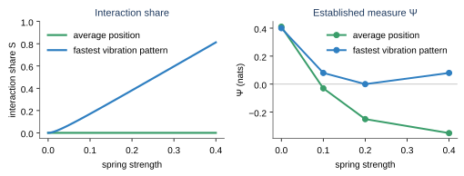
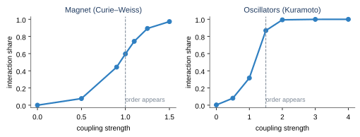
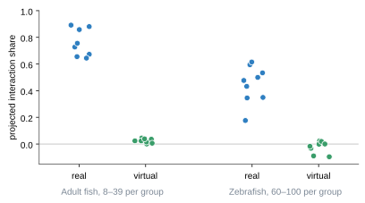
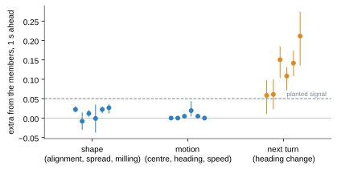
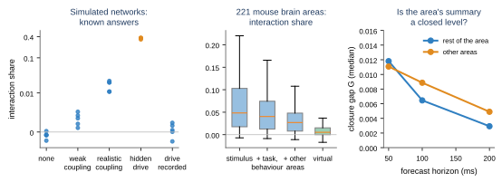
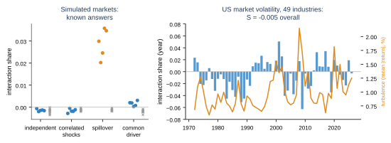
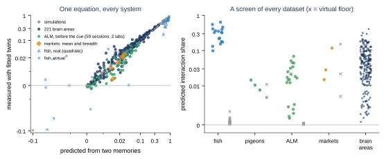
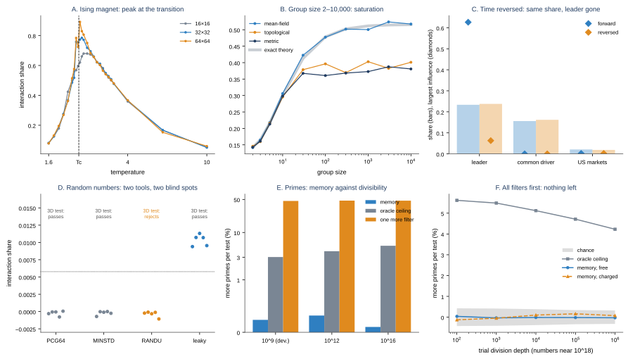

# Telling coordination from coincidence: a no-interaction twin for collective systems

**Eric J. Couture**  
Independent researcher · ORCID [0009-0004-3523-3469](https://orcid.org/0009-0004-3523-3469)

*Draft manuscript for peer review, {DATE}.*

## Abstract

Measures of emergence based on information theory or causal closure ask whether a
group variable has a predictable law of its own. They cannot say whether that law
was produced by the members' interactions: the centre of mass of non-interacting
random walkers passes the standard criterion Ψ. We introduce the **interaction
share** S, the fraction of the forecast error of a system's *no-interaction twin*
(the same members with every interaction removed) that the real group law
eliminates. We also introduce a projected estimator, S_proj, which has
expectation zero without interaction even when the twin's law is not closed in the
group variable. On linearly coupled walkers, S has a closed form: it is exactly
zero for the centre of mass at every coupling, and a machine-checked proof extends
this to any pairwise force obeying Newton's third law. Across magnets,
oscillators and flocking models it rises from 0 to about 1 where collective order
appears. With safeguards against misspecification (time-shifted virtual groups,
synthetic groups with known answers, a positive-control gate) it separates real
fish schools (S_proj 0.54–0.91 cross-fitted, 17 recordings, two species) from
virtual groups that never interacted (−0.10 to 0.07). When interaction is
removed experimentally, the share follows. In the dark, tetra pairs and triads
fall from 0.023 and 0.089 to zero, the level of fish recorded alone, and a
virtual partner that stops responding lowers it from 0.063 to 0.019. We pair S
with a calibrated closure test,
which must detect a planted 5% signal and reject null features before its verdict
counts. With it we show that fish schools are closed in their shape and motion
but not in their next turn, which is carried for about one second by fast fish
at the front.

Transferred unchanged in logic to two new domains, the tools find small shares:
- In 221 mouse brain areas, at most about 3% of the next 50 ms of activity is
  shaped by coordination beyond recorded causes. In motor cortex before
  movement, a share of 1.3% was confirmed in a pre-registered test on 19
  unseen sessions and replicated in a second laboratory (median 2.6%, 19/19
  sessions). Silencing its midbrain input did not measurably change it, but
  that test was underpowered; we estimate that a decisive one needs roughly
  100–300 silenced trials per session.
- US market log volatility carries a share of 1.3–2.9% beyond every
  industry's own history. It was confirmed in a pre-registered test on 36
  years of data not previously analysed (1936–1971, 40 industries; S_proj =
  0.029 [0.017, 0.041], 0.031 after correcting a leak described below).
  On three markets never analysed before (Japan, Europe, Asia Pacific) it
  is 0.002–0.012. Among individual firms it is larger: 1.5–7.9% in seven of
  eight markets (2000–2026), above the region's portfolios in six of seven.

For linear forecasts we show that the share is a **memory gap**: the cost of
forecasting the group with its members' autocovariance instead of its own.
This is the classical loss from forecasting an aggregate with its components'
univariate models (Kohn 1982; Lütkepohl 1987), given here a causal reading as
the forecast a no-interaction twin would lose. With one lag, S = (ρ_g − ρ_m)²/(1 − 2ρ_mρ_g + ρ_m²). Computed from two
autocorrelation curves without fitting any twin, it matches the measured
share in 66 simulated systems and in 221 brain areas (Spearman 0.97). It
predicted the market share before it was measured (0.028), and the shares
of three fresh markets within 0.004. In a quadratic
form that still uses only member memories, it ranks real fish schools by
their measured share (Spearman 0.86). Scored with the same cross-fitting, it is
0.015–0.076 above the full fish twin. For any
group variable that sums a function of the members it applies unchanged; for
non-additive ones (the worst industry) a Monte Carlo memory twin splits the
share into same-day and dynamic coordination. An audit found that our
cross-fitted estimator leaked test data through a stacked fitting stage,
biasing market shares low by up to 0.024; it is corrected, and brain-area
and motor-cortex results are unchanged. The identity also states
the measure's limit exactly: a common input and coupling that produce the same
memories give the same share. Stress tests at the extremes bound the measure
from both sides. In the 2D Ising model, the memory gap peaks at the transition
(0.68, 0.79, 0.89 for L = 16, 32, 64), and the peak moves towards the
critical temperature. From 2 to 10,000 agents it saturates, matching an exact
mean-field formula within 0.011. It is unchanged under time reversal, while
member influence keeps the direction. It cannot see RANDU's purely nonlinear
dependence. In the primes it detects the known anticorrelation of block
counts, but saves at most 0.3% of primality tests. Every analysis was
pre-registered by hash before
being run; the complete record of {N_EXP} experiments, including all failures,
is given in the Appendix.

## 1. Introduction

Collective patterns invite a causal reading: parts that move together are taken
to act together. The inference fails whenever members respond to a shared cause,
such as a crowd leaving at the final whistle, investors selling on the same
news, or neurons following the same stimulus. Distinguishing *coordination* from
*coincidence under common causes* is a central question in collective animal
behaviour, neuroscience, finance and the social sciences.

Formal theories of emergence offer group-level criteria. Causal-emergence
measures such as Ψ (Rosas et al. 2020), dynamical independence (Barnett and
Seth 2023) and computational closure (Rosas et al. 2024) ask whether a
coarse-grained variable predicts its own future, or is closed with respect to
the micro level. These criteria detect *autonomy*. They are silent on its
*origin*. Liardi et al. (2025) showed that Ψ classifies the centre of mass of
non-interacting walkers as emergent, and closure criteria count the molecule
numbers of an ideal gas as closed. In our own flocking simulations, agents that
ignored each other scored higher on Ψ than coordinated flocks (Appendix, e8).
Granger-based G-emergence (Seth 2010) and informational closure (Bertschinger
et al. 2006; Pfante et al. 2014) share this focus on autonomy.

A second literature, in econometrics, has studied the same comparison without
reading it causally: when is an aggregate efficiently forecast from its own
past rather than from its components (Kohn 1982; Lütkepohl 1984, 1987; Pesaran
et al. 1989; Hendry and Hubrich 2011)? Aggregation of independent heterogeneous
members can create long memory (Granger 1980), and a common factor weak in
each member can dominate the aggregate (Granger 1987; Pesaran and Chudik
2014). In finance, spillover indices decompose members' forecast errors into
each other's shocks (Diebold and Yilmaz 2009, 2012), and realized volatilities
share a persistent common component (Bollerslev et al. 2018). In neuroscience,
population activity often has longer timescales than its units (Murray et al.
2014), and synchrony is measured by comparing the variance of the population
mean with that of its units (Golomb and Hansel 2000). In liquid theory, the
collective correlation function splits into self and distinct parts (Van Hove
1954), and the Vineyard (1958) approximation, which builds the collective from
the self part, plays the role of our twin. To our knowledge these literatures
do not cite each other, and none defines an interaction share against a
no-interaction counterfactual.

We propose to measure interaction directly, against a counterfactual: the
system's no-interaction twin. The contribution is sixfold:
1. a definition and estimator (S, S_proj) with exact results and a formal proof
   (Section 2, Section 3.1);
2. a validation protocol for real data, whose controls are themselves tested on
   known answers (Section 2.4), and an interventional test in which
   interaction is switched off experimentally (Section 3.3);
3. a calibrated closure test that turns "is the group a level of its own?" into
   a falsifiable measurement (Section 2.5);
4. applications to animal groups, brain areas and markets, with every
   prediction pre-registered (Sections 3.3–3.6);
5. the memory-gap identity, which links the share to the classical
   aggregation loss, unifies these results, predicts the share without a
   twin, and proves what no linear measure of this kind can distinguish
   (Section 2.6, Section 3.7);
6. stress tests at the extremes (criticality, group size, time reversal,
   purely nonlinear dependence, the primes) that bound what the share can
   and cannot see (Section 3.8).

The aggregation algebra behind item 5 is known. What we add is its
interpretation as an interaction share, the projected estimator and nonlinear
extensions, the calibrated closure test, and pre-registered validation across
three domains.

## 2. Methods

### 2.1 The interaction share

Let x_t = (x_t^1, …, x_t^N) be the members' states and φ_t = c(x_t) a group
variable. The system evolves as x_{t+1} = F(x_t, e_t) + noise, where e_t are
recorded external causes. The **no-interaction twin** F⁰ keeps every member's
own dynamics and responses to e_t, and removes all terms that depend on other
members. Let G be the best forecast of φ_{t+τ} from the group's history and
recorded causes in the real system, and G⁰ the corresponding forecast implied by
the twin. Both errors are evaluated on the real system:

  S = 1 − E[(φ_{t+τ} − G)²] / E[(φ_{t+τ} − G⁰)²].

S = 0 when the twin's law is already the real law for φ, and S → 1 when φ's
predictable behaviour exists only through interaction. S is defined per group
variable and horizon. It measures how much interaction shapes *that* variable,
not how strong interactions are.

### 2.2 The projected share

On data the twin's forecast g⁰_t = Σ_i ĝ_i(x_t^i, e_t) depends on the individual
states, which a law in φ cannot use. When the twin is not closed in φ, comparing
G with g⁰ is unfair and biases S downward (on heterogeneous oscillators, −0.06
with no coupling; e30). The **projected** twin law G⁰_proj is obtained by fitting
the *same* regression class used for G to the target g⁰ instead of φ_{t+τ}:

  S_proj = 1 − MSE(G) / MSE(G⁰_proj).

Without interaction, the members' twin errors are uncorrelated with the group
features, so G and G⁰_proj estimate the same conditional mean, and E[S_proj] = 0
whether or not the twin is closed. This requires that each member's twin
contain the member-level analogues of the group law's features. Whenever the
twin's law is a function of φ in the regression class, S_proj = S. All real-data
results use S_proj with cross-fitting: every forecast is made by models fitted
on other blocks of time or trials.

### 2.3 Estimating the twin

The twin must be identified from recordings of the interacting system. On
simulated walkers and flocks (e24–e27) three routes were compared:
- modelling each member's own dynamics with interactions written in relative
  coordinates was accurate (within 0.005 of exact);
- extrapolating behaviour to zero neighbours was accurate (within 0.004);
- a naive twin fitted to each member's own past was biased. It absorbs part of
  the interaction and inflates S by 0.07–0.80.

The twin must therefore carry an explicit notion of isolation. In each domain it
includes every recorded cause:
- **Fish:** walls, persistent turning and speed dynamics.
- **Neurons:** stimulus, task events, behaviour, session drift and other areas.
- **Markets:** day of week.

### 2.4 Safeguards for real data

1. **Virtual groups** (false-alarm control). Each member's record is shifted in
   time, or its trials are permuted within condition, so members share the
   environment but never interacted. Expected S_proj ≈ 0.
2. **Synthetic groups** (known-answer control). The fitted individual model is
   simulated with and without interaction, and the whole pipeline is rerun.
3. **Positive-control gate.** A recording counts only if the fitted model,
   simulated, produces a cohesive interacting group.
4. **Pre-registration.** For each experiment the predictions and thresholds
   were written into the analysis code, and the file was hashed (SHA-256) into
   a log before it was run. Smoke tests checked structure only. Every outcome
   is reported, and later redesigns disclose earlier results in their
   docstrings.

### 2.5 A calibrated closure test

A group description C_t (for example, the top three principal components of a
population, or a school's shape) is closed at horizon τ if adding member-level
features X_t does not improve its forecast. The closure gap is

  G = 1 − MSE(C, X) / MSE(C)

for a ridge forecaster. Its penalty, and a separate scale on X that can reach
zero, are chosen by blocked cross-validation within the training data, so the
extended model contains the base model. Heavy-tailed features are transformed
as asinh((x − median)/MAD). Intervals come from a moving-block bootstrap. Before
its verdict counts, the test must pass two checks on the same data:
- **Calibration:** a planted signal carrying 5% of the forecast error must be
  detected.
- **Null control:** features from a different recording must yield G ≈ 0.

### 2.6 The memory-gap identity

Let the group variable be the sum φ_t = Σ_i x_t^i of N interchangeable
members, and let both laws be linear in a fixed set of lagged features. Write
o(k) for the member autocovariance at lag k, averaged over members, and g(k)
for the autocovariance of φ. Let Γ_o, Γ_g and γ_o, γ_g be the corresponding
Toeplitz matrices and target vectors. A member's twin, fitted on its own past,
has weights β(o) = Γ_o⁻¹ γ_o. Summed over members, its forecast is
g⁰_t = Σ_j β_j(o) φ_{t−j}, already a linear function of the group's features,
so G⁰_proj = g⁰. The group law has weights β(g) = Γ_g⁻¹ γ_g. Both are
evaluated on φ, so

  S_proj = 1 − MSE(β(g); g) / MSE(β(o); g),

where MSE(β; g) = g(0) − 2βᵀγ_g + βᵀΓ_gβ. The share is the loss from
forecasting the group with its members' memory instead of its own. For
interchangeable members this is the comparison of an aggregate's own-past
predictor with the sum of its components' univariate predictors, studied by
Kohn (1982) and Lütkepohl (1984, 1987). The new reading is causal: under
independence g = N·o exactly, so the gap is produced only by
cross-autocovariances between members, which is what interaction or a shared
input leaves behind. With a single lag, ρ_m = o(1)/o(0) and ρ_g = g(1)/g(0):

  S₁ = (ρ_g − ρ_m)² / (1 − 2ρ_mρ_g + ρ_m²).

Three consequences follow:
- **Correlation is not enough.** S = 0 whenever g ∝ o, however strongly
  members are correlated.
- **The pooling peak.** A persistent shared signal that is weak in each member
  but strong in the total raises ρ_g above ρ_m. For a fixed group size, S is
  largest at an interior per-member signal fraction, and the peak moves to
  weaker signals as N grows. This is the share-level form of Granger's (1987)
  observation that common factors dominate aggregates.
- **Mechanism-blindness.** S depends on (o, g) only. Any two mechanisms that
  produce the same member and group memories, such as an unrecorded common
  input and all-to-all coupling, give the same share. Separating them needs
  recorded causes or perturbation.

In practice S_pred is computed with the windows of the corresponding
measured analysis, using the biased (positive-definite) autocovariance
estimator, and is compared with a virtual floor: the same statistic on
time-shifted members, or on trials permuted across members.

## 3. Results

### 3.1 Exact results and a theorem

For N walkers with x_{t+1} = ((1 − θ)I − γL) x_t + ξ_t (L the chain Laplacian),
every Laplacian mode k is an exact AR(1) with coefficient a_k = 1 − θ − γλ_k,
and the twin has b = 1 − θ. At horizon τ,

  S_k(τ) = (a_k^τ − b^τ)² / [(1 − a_k^{2τ}) + (a_k^τ − b^τ)²].

For the centre of mass (λ₀ = 0), S = 0 at every N, θ, γ. Internal modes grow
as γ²λ_k²/(θ(2 − θ)) at weak coupling. Ψ is largest with no coupling at all
and turns negative for the centre of mass as coupling grows (−0.35 nats),
although that variable's law never changes (Figure 1). All 5 pre-registered
predictions passed, and simulation matched the closed form within 0.005.

In Lean 4 we proved two statements for any pairwise force obeying Newton's
third law, linear or not, over any commutative ring:
- the sum of positions follows the no-interaction law exactly;
- if interactions do not move a group variable, the twin's law is its only
  exact law.

<figure>

<figcaption><b>Figure 1.</b> Spring-coupled walkers (N = 10, τ = 1). Left: S
for the centre of mass (0 at every coupling) and the fastest mode (closed form).
Right: Ψ for the same variables.</figcaption>
</figure>

### 3.2 Simulated transitions

S rises from 0 to near 1 exactly where collective order appears. In the
Curie–Weiss model it rises from 0 to 0.97 (exact), where Ψ falls to −19.8 nats.
In the 2D Ising model it reaches 0.99 at T = 2.3 and ≥ 0.998 below T_c, with a
data-only twin within 0.004. In Kuramoto oscillators S_proj rises from 0.003
uncoupled to 0.999 synchronised (Figure 2). The one failed prediction in this
group, heterogeneous oscillators under the unprojected S, motivated S_proj.
Its fresh pre-registered test passed 6 of 6.

<figure>

<figcaption><b>Figure 2.</b> Interaction share across a mean-field ordering
transition (exact) and Kuramoto synchronisation (S_proj, simulated). The dashed line marks the
transition.</figcaption>
</figure>

### 3.3 Real animal groups

The data are eight recordings of adult fish (8 or 39 fish; Puy et al. 2024) and
nine of juvenile zebrafish (60–100; Heras et al. 2019). The group variable is
polarisation, and each fish's twin keeps wall avoidance, persistent turning and
speed dynamics. Real schools scored S_proj 0.64–0.89 (adult fish) and
0.18–0.62 (zebrafish), on a single chronological 70/30 split. Their virtual
groups scored 0.00–0.05 and −0.10–0.02. Cross-fitted over interleaved blocks,
which is robust to schools drifting within a recording (e77, Section 3.7),
the same twins give 0.72–0.91 and 0.54–0.77.
Synthetic loners scored −0.003, and synthetic schools were recovered exactly
(Figure 3).

Two earlier rounds failed and are reported:
- **e31 (1/4):** the twin lacked persistent turning, which biased virtual groups.
- **e32 (6/8):** the twin was not closed in polarisation, the case S_proj was
  designed for.

The final round passed 7/7 (adult fish) and 6/8 (zebrafish; the two misses
were within 0.005 of threshold). For pigeon flocks (Nagy et al. 2013), no
fitted model reproduced cohesion and the positive-control gate failed in all
three rounds. Real flocks scored 0.5–0.9 against about 0 for virtual flocks,
but no result is claimed.

<figure>

<figcaption><b>Figure 3.</b> S_proj for every real fish recording and its
virtual group.</figcaption>
</figure>

**Switching interaction off (e80, 15/15).** Every result above compares a group
with a constructed counterfactual. Two public experiments on rummy-nose tetras
remove interaction physically. Liu and Burbano (2025) recorded pairs and triads
in a lit and a dark arena; darkness removes vision and leaves the lateral line.
They also recorded single fish alone in each condition. This gives synthetic
groups of fish that never met, and an *iso twin* whose member law is fitted on
fish recorded alone rather than modelled. Escobedo et al. (2026) paired a real
fish with a virtual conspecific that either responds to it (C2) or, with the
same parameters, ignores it (C3), so interaction is one-way.

The members were planar velocities at 10 Hz and the group variable their sum,
forecast 0.5 s ahead and cross-fitted over 30 s blocks with purged training
rows. These settings were fixed on simulated fish with a 0.2 s reaction delay.
Without the delay, strongly coupled fish lock together and the member twin
misses interaction (the limit found in e77).

| Condition | n | S_proj, member twin [90%] | S_proj, iso twin [90%] |
| --- | --- | --- | --- |
| Pairs, lit | 9 | +0.023 [+0.019, +0.028] | +0.087 [+0.055, +0.121] |
| Pairs, dark | 10 | −0.001 [−0.001, −0.000] | +0.027 [+0.007, +0.050] |
| Triads, lit | 9 | +0.089 [+0.076, +0.099] | +0.200 [+0.134, +0.247] |
| Triads, dark | 10 | +0.001 [−0.001, +0.003] | +0.007 [+0.001, +0.012] |
| Synthetic groups of single fish | 40 | −0.003 to +0.001 | −0.001 to +0.038 |
| VR, clone responds (C2) | 21 | +0.063 [+0.058, +0.066] | |
| VR, same clone ignores (C3) | 11 | +0.019 [+0.012, +0.025] | |

- **Darkness.** In the dark the share fell to the level of fish that never
  met. Every lit recording scored above every dark one (Mann–Whitney
  p = 0.0001 for pairs and for triads; with the iso twin, p = 0.003 and
  0.0001).
- **Reciprocity.** With the virtual partner's behaviour fixed, removing its
  response lowered the share by 0.044 [0.036, 0.052], and one-way interaction
  remained detectable.
- **Memory gap.** It matched the measured share within 0.01 in 37 of 38 tetra
  recordings.
- **Controls.** Time-shifted and synthetic groups were clean.

The iso twin's dark values (0.007–0.027) and its synthetic range (up to 0.038)
reflect differences between individual fish, which a twin fitted on other fish
cannot remove. A slower, differently parameterised clone (C1, 0.013) scored
below C3, so the share also depends on the partner's kinematics. Only C2
against C3 isolates reciprocity.

**A graded test in large schools (e83).** Lafoux et al. (2023) filmed schools
of about 50 tetras for 50 minutes at eight fixed light levels (0–900 lux).
- **Method.** FastTrack identities last a median of 4–80 s per recording, so
  we estimated the memory gap from short-lag statistics:
  - member autocovariance from pairs of frames within a track;
  - cross-covariance from pairs of tracks that coexist in time;
  - g = n·o + n(n−1)·c with n = 50.

  On simulated 50-fish schools with tracks broken in the same way, this
  recovered the full-identity gap within 0.011.
- **Result: no dose–response.** The pre-registered prediction failed: the
  Spearman correlation between light and share was −0.14 (15 recordings).
  Every school scored 0.10–0.28, darkness included (0.14, 0.23); time-shifted
  versions scored ≤ 0.0013.
- **Why (exploratory).** Velocity correlation between dark fish fell with
  distance, from 0.28–0.43 under one body length to about zero beyond 20,
  close to the lit profile. Light mainly changed dispersion: 9–30% of pairs
  were over 20 body lengths apart in the dark, against 2–4% when lit. Local
  interaction therefore persisted at "0 ± 0.1 lux", through the lateral line
  or residual light, so this design does not switch interaction off.

### 3.4 Is a school a level? Closure and steering

With the calibrated test (planted signal detected in 21 of 24 checks), six
8-fish schools are closed in shape (G ≤ 0.03) and motion (G ≤ 0.02) at 1 s.
They are open in their next turn, where G is 0.06–0.21 in every school; at 3 s
it closes. A learned influence map, assuming only mirror symmetry, located the
missing information in all eight real schools and in no virtual group:
- **Front fish steer:** a fish at the front heading off the school's line
  predicts a turn that way, while rear and side fish predict the opposite.
- **Speed matters most:** fast fish carry the information (6–22%, against
  3–11% for heading alone).

This rediscovers known leadership effects (Bumann and Krause 1993; Katz et al.
2011; Jolles et al. 2017; Puy et al. 2024) from a general test (Figure 4). In
zebrafish the map's structure replicated in 9 of 9 groups, but its strength
depended on the test segment. Pigeon flocks were closed in their turn at 1 s.

These experiments tested on the last 30% of each recording. A pre-registered
audit (e78, 10/11) reran all seven with the test moved to the first or the
middle 30%, with every fitting stage moved too; the original segment
reproduced every published number exactly. Shape and motion stayed closed
(G(shape) < 0.05 in 17 of 18 school-segments), the turn stayed open
(0.08–0.25), and front fish steered in every segment. Of the 24 real-data
verdicts, 20 and 22 were unchanged. The zebrafish strength was confirmed in
8 of 9 groups early in the recordings, against 3 and 2 of 9 later. The one
failure was a calibration I had misclassed as simulation-only. Seven
further pre-registered experiments tested where levels stay open:
- the hypothesis that levels stay open along neutral directions failed;
- in oscillators, a group is open exactly when some member is measurably
  loose, and those members carry the information (21/21);
- flocks and fish show no such members.

<figure>

<figcaption><b>Figure 4.</b> Closure gap of six 8-fish schools at 1 s, by
variable, with 95% intervals; the dashed line marks the calibrated planted
signal.</figcaption>
</figure>

### 3.5 Brain areas

The data are Neuropixels recordings from 39 sessions (Steinmetz et al. 2019),
giving 221 areas with at least 30 neurons:
- **Members:** neurons in 10 ms bins.
- **Group:** the area's total over the next 50 ms.
- **Twin:** a per-neuron Poisson model with ridge penalty and safeguarded
  Newton steps.
- **Recorded causes:** nested sets, from the stimulus, to task events,
  behaviour and session drift, to other areas.

Simulated spiking networks set the scale:
- **Realistic coupling** gives S_proj 0.01–0.05.
- **An unrecorded shared input** gives about 0.35, falling to 0 once recorded.

The first attempt (e61, 4/9) was declared void after a numerical divergence
in the twin. The repaired analysis (e62, 8/12) found the following (Figure 5):
- median S_proj 0.048 beyond the stimulus, 0.040 beyond task, behaviour and
  drift, and 0.027 beyond other areas as well (positive in 80% of areas);
- virtual groups 0.005.

The calibrated closure test (e63, 4/7) showed that an area's top three
components with recorded causes are nearly closed: the rest of the area adds
G = 0.012 at 50 ms and 0.003 at 200 ms, and other areas add 0.011. Null
features gave exactly 0 in 221 of 221 areas.

To separate local coupling from upstream input, we analysed midbrain (PPN/MRN)
silencing during motor-cortex (ALM) recordings (Inagaki et al. 2022; 21
sessions).
- **e64 (2/8).** The first design failed calibration: in a window
  straddling the go cue, a time-locked transient estimated from about 40
  trials mimicked a shared input. Its real-data numbers are void.
- **e65 (4/7).** A redesign developed on simulations only used the steady
  pre-cue light period and linear twins. It was calibrated: independent
  networks scored −0.02, and a simulated input switched off fell from +0.30
  to −0.02 in 10/10 seeds.

In ALM, the control share was +0.001 (median), and silencing left it
unchanged (median change 0.000). The pre-registered difference-in-differences
passed (p = 0.013), but only because trials later chosen for silencing scored
higher *before* the light (18 of 21 sessions). We do not count it as evidence.
With all ~270 control trials per session instead of ~40 (exploratory, e70),
ALM shows a small share in the 1.5 s before the cue: a median of 0.014,
positive in 19 of 21 sessions.

This was then pre-registered (e71, 9/10) on the 19 sessions of the dataset
with ≥ 20 units that had never been analysed:
- median S_proj 0.013, positive in 16/19;
- memory-gap prediction 0.016, Spearman 0.86;
- virtual groups (trials permuted per neuron) all within ±0.005;
- after removing each neuron's slow drift across neighbouring trials,
  0.014 (17/19 positive).

A twin-free silencing test, the difference-in-differences of the memory-gap
excess over its permutation floor, was calibrated on fresh simulations:
- independent and coupled networks stayed within ±0.03;
- a hidden input switched off fell by 0.15–0.33.

It had marginal power at ALM's share size: a weak simulated input was
detected with p = 0.039 over 21 sessions. In ALM the effect was +0.002
(10/21 negative, p = 0.67). By the pre-registered reading (control excess
0.011 < 0.02), the test is inconclusive.

**Replication and power (e73, 7/7).** No public dataset has ≥ 100
steady-period silenced trials with ≥ 20 ALM units:

- in DANDI 000009, thalamus silencing collapses ALM activity;
- DANDI 000011 has about 13 units and about 30 trials per condition;
- DANDI 000006 has no stimulation.

We therefore replicated the e71 pipeline, unchanged, on the 19 sessions of
DANDI 000006 (Economo et al. 2018) with ≥ 20 units. These differ in
laboratory, task and probes, and had never been analysed. The 1.5 s delay
gave:

- median S_proj 0.026, positive in 19/19;
- memory-gap prediction 0.029, Spearman 0.95;
- virtual groups all within ±0.005;
- beyond drift 0.025 (19/19).

A power simulation used e71's network with an input of ALM's size (control
excess about 0.011). A 21-session sign test detected its removal with power
0.74 at 40 silenced trials per session and 1.00 at 80–320. Coupled networks
without input dependence gave false-positive rates of 0.01–0.02.

e71's real difference-in-differences was 1.4–2.5 times noisier than the
simulations (interquartile and standard-deviation estimates). Scaling by
that noise (exploratory) puts a decisive experiment at roughly 100–300
silenced trials per session.

<figure>

<figcaption><b>Figure 5.</b> Left: simulated networks with known answers.
Middle: S_proj of 221 brain areas with nested recorded causes, and virtual
groups. Right: closure gap of the area's summary state by horizon.</figcaption>
</figure>

### 3.6 Market volatility

The members are 49 US industry portfolios (French data library; 13,801 days,
1972–2026), each measured by its daily |return|. The group is their mean. The
twin is each industry's HAR volatility forecast (Corsi 2009) plus day-of-week
effects, cross-fitted over 250-day blocks.

The simulated GARCH markets (Bollerslev 1986) were developed on separate seeds,
then pre-registered:
- independent markets and markets with correlated shocks scored 0;
- volatility spillover between members scored 0.020–0.036;
- a common GARCH volatility driver with loading 0.8 was **not** counted
  (0.000–0.003).

Because each member's own history reveals the common state, every twin learns
it. On raw |return| the real market scored S_proj = −0.005 [−0.011, +0.002],
with clean virtual groups. It scored no higher in 1972–1997 (−0.014) or
1998–2026 (0.000), and no higher in turbulent years (rank correlation 0.12;
Figure 6). A replication on 467 stocks over 2013–2018 is void. Over five
years, time shifts of 500–759 days could not break the stocks' shared
episodes, and the virtual groups scored about 0.5.

The memory-gap identity (Section 3.7) predicted +0.016 for this market, not 0.
The discrepancy traced to heavy tails: on raw |return| a few crash days
dominate the out-of-sample error. On log volatility, log(|r| + 0.05), the
measured share was +0.013. Because that was found after the fact, it was
tested as a new pre-registered experiment (e69) on data not previously
analysed:

| Data | S_proj, log volatility [90%] | S_pred | S_proj, raw | virtual (log) |
| --- | --- | --- | --- | --- |
| 40 industries, 1936–1971 (holdout) | +0.029 [+0.017, +0.041] | +0.028 | +0.012 | −0.004 to −0.001 |
| 49 industries, equal-weighted, 1972–2026 | +0.017 [+0.010, +0.024] | +0.019 | −0.003 | −0.002 to +0.004 |
| 49 industries, value-weighted, 1972–2026 | +0.013 [+0.006, +0.020] | +0.015 | −0.005 | −0.001 to 0.000 |

All five predictions passed: a positive holdout share, agreement with S_pred
within 0.01, clean virtual groups, replication on equal-weighted portfolios,
and a smaller raw share. US market volatility therefore carries a small but
genuine coordination share. These estimates are slightly low because of the
leak described in Section 3.7; leak-free, the holdout share is 0.031
(S_pred 0.028) and equal-weighted 1972–2026 is 0.019 (S_pred 0.019). The share cannot say whether it reflects
spillover or a slow common driver that members reveal poorly.

**Individual firms (e79, 8/9).** A portfolio's volatility history reveals the
market's state well, so by the simulations above it should hide
coordination that individual firms show. The 2013–2018 stock set was too
short, so we used Yahoo Finance daily prices from 2000 to 2026 for today's
members of eight indices: 17–40 firms per market with a full history,
survivors only. We ran the leak-free pipeline unchanged.
- Firms gave S_proj = 0.015–0.079 in seven markets (lower bounds > 0);
  Hong Kong (17 firms) gave 0.008 [−0.001, 0.022].
- The firms exceeded the region's portfolios over the same dates in six of
  seven comparisons. The UK, German and French firms gave 0.023–0.045,
  against 0.002 for the European portfolios.
- The memory gap was within 0.008 in every market, for mean and breadth,
  with rank correlation 1.00.
- The virtual groups were within ±0.004.
- The one miss was a simulated-null tolerance (0.0055 against 0.003).

That firms show more than portfolios is what aggregation theory leads one to
expect (Granger 1987), and is consistent with a persistent common volatility
component (Bollerslev et al. 2018). The new result is that the memory gap
predicts its size in every market.

**Against the Diebold–Yilmaz index.** We compared the memory gap with the
total spillover index (Diebold & Yilmaz 2012; VAR(1), generalized variance
decomposition at horizon 10), both pre-registered.
- **Simulations with known answers.** The index registered contemporaneously
  correlated shocks (44–46%, against 0.7% for independence) and missed
  lagged volatility spillover (0.6%), at VAR orders 1–22. The share did the
  reverse (0.001–0.003 against 0.022–0.028). In 500-day windows the index read
  16% under independence and 15% under spillover; the share's medians were
  0.005–0.009 and 0.021. With 400 members the share was 20 times faster.
- **Real markets (294–304 rolling windows per market).** Rank correlations
  between the two ranged from −0.82 to +0.64. Neither improved an
  out-of-sample HAR forecast of next month's volatility beyond the other:
  1 of 8 markets for the share, 2 of 8 for the index. Two predictions failed.
- **Future correlation, not replicated.** Adding the share to HAR plus the
  index reduced the out-of-sample error for next month's mean correlation
  between firms in all 8 markets (0.3–12.9%), with a negative sign that was
  not predicted. That test omitted the current correlation (last 21, 63 and
  500 days); with it included, gains remained in 3 of 8. A confirmation on
  six markets not used before, with the sign pre-registered, passed 2 of 6
  predictions:
  - the pooled coefficient stayed negative (−0.008 per s.d. [−0.011, −0.003];
    placebo +0.002 [−0.002, +0.007]);
  - per market, the sign was negative in 3 of 6;
  - out-of-sample gains appeared in 2 of 6, with or without the control.

The index used daily absolute returns here, not the intraday range of the
original, which may disadvantage it.

<figure>

<figcaption><b>Figure 6.</b> Left: simulated markets with known answers
(crosses: virtual groups). Right: S_proj of US market volatility by year (bars)
and the market's turbulence (line), raw |return|.</figcaption>
</figure>

### 3.7 One equation across domains

The memory-gap identity (Section 2.6) was tested in three pre-registered
experiments and one exploratory screen (Figure 7).

**Simulations and brain areas (e67, 7/8).**

- In 52 linear simulations, S_pred matched the cross-fitted S_proj within
  0.003. The simulations covered factor (common-input), mean-field and
  local-coupling models across group sizes 10–200, and the match was equally
  good for all three.
- The pooling peak appeared as predicted.
- In 14 GARCH and spiking-network simulations it matched within 0.02.
- In the 221 brain areas of Section 3.5, S_pred matched S_proj (Spearman
  0.97, median gap 0.006), and it reproduced the Poisson-twin results of e62
  (Spearman 0.93).
- The miss was raw market volatility, resolved in Section 3.6.

**Fish schools (e68, 3/4).** Fish are outside the identity's guarantee. Their
S_proj used nonlinear twins and polarisation, a nonlinear group variable.
With only each fish's heading (as a unit vector) and the school's summed
heading:
- all 17 virtual groups scored about 0;
- every real school scored above its virtual groups (17/17);
- the 34 groups were ranked correctly (Spearman 0.76).

Within real schools, however, the ranking was reversed (−0.65): adult fish
have the highest S_proj but the lowest S_pred.

**A quadratic memory gap (e72, 6/6).** The diagnosis, written before the test,
was that centring each heading discards the level of polarisation. A
no-interaction twin predicts that a tightly aligned school relaxes towards
disorder. Polarisation squared is a sum over pairs, Nφ² = 1 + (1/N)Σ_{i≠j}
uᵢ·uⱼ. For independent members, the twin's forecast of it is therefore exact
given each member's own forecast mᵢ = μᵢ + Σ_w β_w(o)(window sums of uᵢ − μᵢ):

  φ₀² = (N + |Σᵢ mᵢ|² − Σᵢ |mᵢ|²) / N².

G (cubic in the school's windowed φ) and G⁰_proj (the same regression fitted
to φ₀²) were scored on the real φ², cross-fitted. Results:
- simulated independent walkers scored |S_q| ≤ 0.013 (10/10);
- simulated aligning groups scored 0.51–0.87 (10/10);
- virtual fish groups scored within ±0.05 in 16/17;
- every real school exceeded its virtual groups by ≥ 0.1;
- within real schools, Spearman(S_q, S_proj) = +0.86;
- the median |S_q − S_proj| was 0.140 (threshold 0.15).

S_q runs above S_proj (adult fish 0.80–0.93 against 0.64–0.89; zebrafish
0.57–0.80 against 0.18–0.62). The construction applies to any group variable
quadratic in the members.

**Why S_q ran above the fitted twins (e77, 9/10).** We had attributed the
excess to what fuller twins explain (walls, persistent turning). Simulated
schools with a known twin did not support this. The memory twin was never
more than 0.03 above the true twin, and was far below it when fish locked
onto delayed neighbours (0.01 against 0.995), since each fish's own past
then carries the school's heading. The fitted full twin did not absorb
interaction even under misspecified interaction rules. On the real schools
we scored both twins on φ² with e72's law. Each fitted part, including the
full twin, was trained without the test blocks. Medians of the pieces of
the 0.140 excess:

- the published single 70/30 split: 0.068 (up to 0.50 in one drifting
  10-minute zebrafish recording; zero in stationary simulations);
- the target and law: 0.016;
- the full twin's extra information: 0.031 (0.015–0.076, positive in all
  17 schools; Spearman 0.98 between the two twins).

On the same 70/30 split, the full twin on φ² reproduced the published S_proj
(median gap 0.031), and virtual groups stayed within ±0.1 (17/17). The
memory gap scored on that split was a median 0.074 from the published
values; the registered threshold was 0.07. For fish, the quadratic memory
gap minus about 0.03 estimates a full individual model's share.

**Any group variable (e74, 10/10).** Two cases cover the rest.

- *Additive variables.* A variable G = Σᵢ h(xᵢ) is the sum of transformed
  members, so its share is the linear memory gap on h(xᵢ).
- *Non-additive variables.* For a variable such as the maximum, we
  construct a Monte Carlo memory twin: each member's own cross-fitted HAR
  forecast plus draws of its own out-of-fold residuals, taken from days
  when its forecast was in the same decile, independent across members,
  with G⁰ = E[max] over 200 draws.

A *joint* twin draws every member at the rank its residual had on the same
training day (the empirical copula). It keeps same-day dependence, so its
share is the dynamic coordination alone. The Monte Carlo twin is
approximate (about 0.015 in independent markets), so shares are reported
minus their virtual floor.

Members were industries' log volatility, as in e69.

- **Breadth** (the fraction of industries above their own 95th
  percentile) matched its memory gap in 40/40 simulated runs.
- **The worst industry**, in GARCH simulations, was about 0 against both
  twins in independent markets. With correlated same-day shocks or a
  common factor it was 0.16–0.42, falling to about 0 against the joint
  twin. With spillover it was 0.015–0.024.
- **Real data**, on the unseen equal-weighted 1936–1971 industries: breadth
  S = 0.022 against S_pred = 0.024 (lower bound 0.007). The worst
  industry's excess share was 0.28, of which 0.24 is same-day.

The pre-registered hypothesis that extremes carry extra dynamic
coordination ("contagion") passed by 0.001 (0.038 against a threshold of
0.037). It reversed in both secondary datasets, value-weighted 1936–1971
and equal-weighted 1972–2026, so we do not regard it as supported. Breadth
on equal-weighted 1972–2026 missed its prediction (0.006 against 0.016,
not pre-registered).

**An exact twin for non-additive variables (e75, 5/10).** e74's Monte Carlo
twin read 0.018–0.027 for independent markets, while an oracle twin with
the true GARCH volatilities read 0 (±0.002). The fix models each member in
returns:

- its scale is a cross-fitted ridge of |rᵢ| on exponentially weighted means
  of its own past |rᵢ| (decays 0.8, 0.9, 0.97), floored at 0.25 × its
  median;
- its standardized shocks |rᵢ|/σᵢ are drawn from its own out-of-fold days;
- the twin rebuilds log(σᵢuᵢ + 0.05).

All five simulation predictions passed:
- independent markets |S| ≤ 0.002 with nothing subtracted;
- 200/200 virtual groups within ±0.007;
- correlated shocks and a common factor caught in both the max and a
  systemic-day indicator (≥ 20% of members above their own 95th
  percentile), and removed by the joint twin.

All five real-data predictions failed. The primary set was never-analysed
value-weighted industries, 1926–1935 (37 industries, 2,824 days):
- one virtual draw of the systemic indicator reached −0.026 (limit 0.02);
- the replication's same-day part of the max was 0.089 (needed 0.1);
- systemic days showed no share in 1926–1935 (0.004 [−0.036, 0.018]),
  against 0.03–0.05 with positive lower bounds in all three longer sets;
- breadth fell 0.03 below its memory gap on both 1926–1935 sets;
- e74's floor correction overstated the max by 0.069 on one set.

A key collision in the code first scored R1–R4 on the wrong dataset. It was
fixed, hashed as a correction with the predictions unchanged, and both runs
are archived. With the exact twin, the worst industry's share over
1936–2026 is 0.16–0.22, nearly all same-day. Breadth's memory gap
overstated the measured share in three of five real sets, always in the
same direction. We first read this as a limit of the identity for
rare-event members. It was a flaw in the measurement instead (e76, below).

**A leak in the cross-fitted share (e76, 10/12).** The estimator of Section
2.2 fits G⁰_proj for test fold f on the twin's out-of-fold forecasts from the
other folds. Those forecasts come from member models fitted on folds that
include f, so the twin has partly seen the test data. This flatters the twin
and biases S_proj low; it cannot bias it high. The leak-free estimator fits,
for each test fold, every member model on the other folds, applies it to all
days, and fits G⁰_proj on those forecasts. A pre-registered audit had three
parts:

- **Simulations** (fresh seeds, 14,000 days). The leak lowered S in 39/40
  cells, and e66's estimator read −0.003 to −0.001 in independent markets.
  Leak-free, independent markets were within 0.0013 of 0, and all 30
  dependent cells matched S_pred within 0.003.
- **Fresh markets.** Daily value-weighted 25 size × book-to-market
  portfolios of Japan, Europe and Asia Pacific ex Japan, 1990–2026 (9,458
  days, never analysed). Leak-free S matched S_pred within 0.004 for mean
  log volatility and breadth in all three, with virtual groups within
  0.0015. The leak was larger for breadth than for the mean in all three
  (Europe's breadth went from −0.015 to −0.002). Coordination is small in
  Japan and Europe (0.002, lower bounds at 0), so the prediction of a
  positive share in two of three regions failed; Asia Pacific's is 0.012
  [0.005, 0.018].
- **Reanalysis.** Brain areas barely moved (median change +0.0005;
  Spearman with S_pred 0.975 before and after), but the median gap to S_pred
  did not shrink (0.0061 against 0.0057), which failed a prediction. ALM's
  38 sessions stand (median 0.018 to 0.019, 37/38 positive), and e67's 52
  linear simulations still meet their tolerance.

Leak-free, breadth matches S_pred on all five US sets (exploratory; for
example 0.015 against 0.016 on equal-weighted 1972–2026). For any additive
group variable, rare-event members included, the memory gap is an estimate
of the share.

**A screen (e70, exploratory).** Requiring no twin, S_pred serves as a screen:

- **Fish:** S_pred 0.10–0.64, with floors ≤ 0.003.
- **ALM before the cue:** median 0.017 with floors ≤ 0.001. The full
  cross-fitted measurement on the same trials gave 0.014 (Spearman 0.94).
- **Pigeons:** faint (0.009–0.015 against floors of 0.003–0.007), consistent
  with their closed turn at 1 s.
- **Markets:** industries 0.015 and 0.028, stocks over five years 0.117, all
  above their floors (≤ 0.009).

The virtual floor shifts each member by its own offset, and the offsets must
be spread over the whole record. The screen as first run drew them from its
middle half. That moves every member by about half the record and keeps slow
regimes aligned, which raised the market floors to 0.007–0.152 and made the
stock screen look inconclusive. The fish and trial floors were unaffected.

<figure>

<figcaption><b>Figure 7.</b> Left: S_pred from two memory curves against
cross-fitted S_proj for simulations, brain areas, ALM, markets (log
volatility) and fish (quadratic form; triangles: real schools; crosses:
virtual groups). ALM includes the 19 unseen sessions of e71 and the 19
Economo sessions of e73; markets include breadth (e74). The dashed line is equality. Right: S_pred as a screen of every dataset,
with virtual floors (grey crosses) as first computed; the market and pigeon
floors are lower with whole-record shifts (see text).</figcaption>
</figure>

### 3.8 Testing the extremes

Six experiments (e84–e89) applied the share and memory gap where the answer
is known or where they might fail. Each was developed on one range, seed set
or period, frozen by hash, and run once on held-out data.

**Criticality (e86, 4/5).** In the 2D Ising model (heat-bath dynamics,
spins as members, magnetization as the group variable; 40,000 sweeps after
5,000 of burn-in), the memory gap S_pred is 0.08 deep in the ordered phase
and 0.05–0.06 at T = 10. It peaks near the transition at 0.680, 0.785 and
0.891 for L = 16, 32 and 64. The peak temperature (2.50, 2.35, 2.30) moves
towards T_c = 2.269 (Onsager 1944), as the susceptibility peak does. For
T ≥ 3.4, the larger lattices are within 0.013 of L = 16, as short-range
physics requires, and with J = 0 the gap stays at 0.0003. The
virtual-lattice control failed: near T_c, time-shifted lattices read up to
0.094 at L = 64, against a pre-registered limit of 0.02, because critical
slowing down leaves the record few independent fluctuations of the
magnetization.

**Group size (e88, 6/6).** Agents in a periodic square at fixed density
aligned their 2D velocity with their neighbours,
v′ = a[(1 − w)v + w·v̄_nbr] + noise with a = 0.9 and w = 0.5, under
mean-field, topological (7 nearest) and metric (radius 1.5) neighbourhoods,
for N = 2 to 10,000. The group variable is the summed velocity. For the
mean-field rule, the group and mean-member autocovariances have a closed
form, g(k) = N a^k/(1 − a²) and
o(k) = a^k/(N(1 − a²)) + ((N − 1)/N) b^k/(1 − b²), with
b = a(1 − w) − aw/(N − 1). The memory gap measured from simulation matched
it within 0.011 at every N (0.142 at N = 2, 0.5155 at N = 10,000). The
gap rose steeply to N ≈ 30 and then levelled off, at 0.50–0.52 for the
mean-field rule and 0.36–0.40 for local rules. Between N = 1,000 and 10,000
it varied by at most 0.023. Virtual groups stayed at or below 0.0007. The
group's memory is the same at every size; what saturates is how much of it
each member carries. The share characterizes the rule, not the group's
size.

**Time reversal (e89, 5/5).** Autocovariances are symmetric in lag, so the
memory gap is exactly invariant under time reversal; numerically, the
difference was at most 3.7 × 10⁻¹⁵. The cross-fitted share differed by at
most 0.006 (30 US industries, held out 1972–2026: 0.021 forwards, 0.019
reversed). Member influence, the gain in group forecast from adding one
member's history, is directional. A planted leader's influence fell from
0.62 to 0.06–0.07 under reversal. A common driver produced no leader in
either direction, and no industry led either way (influence ≤ 0.002). The share measures how much coordination there
is; direction must come from influence or intervention.

**Purely nonlinear dependence (e87, 5/5).** Eight streams were drawn from
each of four generators (five seeds, 20,000 steps): PCG64, MINSTD, RANDU
and a "leaky" generator in which a stream occasionally (probability 0.1)
copies the previous output of the next stream. RANDU's consecutive triples
lie on 15 planes (Marsaglia 1968), but they carry no linear correlation.
Its cross-fitted share was −0.0011 to −0.0001, as for the sound generators,
while a 20³-cell χ² test on a million triples rejected it (p underflowed
to 0). The leak gave a share of 0.009–0.011, above the no-coordination
bar, and passed the triple test (p = 0.01–0.6). Linear forecasts see only second-order structure, so the
share and classical uniformity tests have complementary blind spots.

**The primes (e84, 9/9; e85, 8/8).** Prime counts in aligned blocks of
30,030 integers, split by last digit (1, 3, 7, 9), formed the members, and
the total count formed the group. The counts are sub-Poissonian with a
negative lag-1 correlation (−0.064, −0.041 and −0.015 at 10⁹, 10¹² and
10¹⁶), as the Hardy–Littlewood conjectures imply (Montgomery and
Soundararajan 2004). The memory gap detected this without fitting a twin,
and twinshare reported no coordination across last digits. As a search
heuristic, memory added at most 0.32% more primes per primality test.
Perfect knowledge of every block's count would add 4.0–5.2%, and trial
division to 1,000 instead of 101 adds 47%. In e85, all standard sieving was
applied first, at depths from 101 to 10⁶, near 10¹⁷ and 10¹⁸, and the cost
of the memory features was charged against the search. Memory's gains were
all within 1.7 matched random s.d. of zero (mean +0.02%), while each tenfold
deeper filter saved 19–47%. A Buchstab-function calibration of the residual
density matched the observed ratios (0.9909 against 0.9905, 0.9952 against
0.9948), and a planted 3% block signal was recovered (+2.2%, +1.7%).

<figure>

<figcaption><b>Figure 8.</b> A: memory gap of the 2D Ising magnetization
against temperature (L = 16, 32, 64; dashed: T_c). B: memory gap against
group size for three neighbourhood rules, with the exact mean-field value
(grey).
C: S_proj (bars) and largest member influence (diamonds) forwards and time
reversed. D: S_proj for eight streams from four generators (five seeds;
dotted: mean no-coordination bar), with the verdict of a 20³ triple χ²
test. E: additional primes per primality test from block memory, from an
oracle that knows every block's count, and from one deeper trial-division
filter. F: memory's gain near 10¹⁸ after trial division to each depth,
with free and charged features; grey: ±3 matched random s.d.</figcaption>
</figure>

## 4. Discussion

**Autonomy is not interaction.** Closure and information-theoretic criteria
ask whether a group variable has its own law. The interaction share asks
whether interaction made it, and the two can disagree in either direction:
- the centre of mass of coupled walkers is autonomous but untouched by
  interaction (S = 0);
- the turn of a fish school is shaped by interaction (S_proj high) yet not
  closed (G > 0).

**What the share counts as coordination.** S_proj counts any predictable
group-level structure that the members' own histories and recorded causes
cannot supply. That includes local coupling, spillover and herding. It also
includes an unrecorded common input, but only to the extent that members' own
records reveal it poorly. With noisy spike counts, a shared drive is poorly
revealed and is flagged at ten times the size of realistic coupling. With
market volatility, a common driver is visible in every member and is not
flagged. Which regime applies is a property of the domain and must be
established by simulation before real data are read. We regard this as the
measure's main interpretive limit, and also as a precise statement of what it
means for a group to be "more than its members".

**One equation.** The memory gap explains why the domains differ. Brain areas
over tens of milliseconds and market volatility over days both behave as
levels whose members each carry most of the shared signal. Their group
memory barely exceeds their members' memory, and the share is a few percent.
In fish schools, interaction feeds the school's heading back into every fish,
the school remembers far longer than its members, and the share is large.
The method has found coordination where it is known to exist, lost it when
interaction was switched off (e80), found small amounts where small amounts
were expected, and has stated when it could not tell:
pigeons, the e64 design, and the stock replication. The identity also turns
the measure's interpretive limit into a theorem. A share built on linear
forecasts sees only second-order memory, so no reanalysis of the same signals can separate
common input from coupling; only recorded causes or intervention can.

**At the extremes.** The stress tests of Section 3.8 locate the measure
among known physics and mathematics. The memory gap behaves like a
phase-transition marker. It is near zero when nothing moves together and
when nothing interacts, largest at criticality, and it sharpens with
system size. It is intensive in group size, so shares are comparable
between groups of different sizes once neighbourhoods are full. Its
second-order nature has two corollaries that hold beyond linear systems:
the share is blind to the arrow of time, and to dependence with no linear
trace (RANDU). The first is covered by the influence decomposition and the
second needs nonlinear features or classical tests. The primes give a
clean negative with working controls: the gap recovers genuine
number-theoretic structure, but that structure is worth fractions of a
percent next to divisibility.

**Limitations.**

- **Identifiable twin.** The twin must be identifiable (it was not for pigeons).
- **State dependence.** S_proj can depend slightly on the states used to fit
  G⁰_proj (at most 0.055).
- **Long series.** Virtual groups need series long compared with shared
  episodes.
- **Small samples.** Small samples around sharp events mimic shared input.
- **Heavy tails.** In heavy-tailed data a few extreme values can dominate the
  error and hide a share; transforms should be pre-registered.
- **Nonlinear group variables.** The memory-gap identity is exact for
  linear laws and sums of any member transform. A quadratic form handles
  alignment-type variables and runs about 0.03 above a fully modelled
  fish twin. When members lock onto the group, the memory gap misses
  interaction a model of the isolated member would count (e77).
  Non-additive variables need a Monte Carlo twin. It is exact only when
  members are modelled in the variable where their randomness lives
  (e75).
- **Stacked cross-fitting.** Every fitted stage must exclude the test
  data. Our estimator did not, which biased market shares low until e76;
  trial-based neural estimates were barely affected. A single chronological
  split is pessimistic for drifting recordings (e77); the fish closure
  verdicts do not depend on it, but zebrafish turning strength does (e78).
- **Perturbation power.** ALM's confirmed share (1.3–2.6%) is below what
  ~40 silenced trials per session resolve; no public dataset has the
  roughly 100–300 needed. Its origin is open.
- **Surviving firms.** The individual-firm panel contains only today's index
  members with full histories (e79).
- **Interventional scope.** Interaction was switched off experimentally only
  in fish groups of two and three (e80); larger groups and other domains rest
  on observational controls. In 50-fish schools, the dark condition left
  local coordination intact, so no graded test was possible (e83).
- **Forecaster class.** Closure is relative to a forecaster class, made
  trustworthy by calibration but not absolute.
- **Second-order blindness.** The share is (nearly) time-symmetric and
  misses dependence with no linear correlation (e87, e89).
- **Critical slowing down.** Near a phase transition, virtual-group floors
  need records far longer than the slowest relaxation time (e86).
- **Prior art.** The one-lag formula or its exchangeable-member form may
  appear in the aggregation literature (Lütkepohl 1987); our search found
  the comparison but not this formula, and was not exhaustive.

**Pre-registration.** Of {N_EXP} experiments in the record, {N_SCORED} have
numeric scorecards, totalling {N_PASS} of {N_PRED} predictions passed. The
failures were as informative as the passes:
- the Ψ false positive (e8);
- a twin that absorbed interaction (e24);
- the unprojected share (e30);
- the pigeon gate (e35–e37);
- a diverging neural twin (e61);
- a cue-locked artefact (e64);
- short-series virtual groups (e66);
- heavy tails hiding the market share (e67, confirmed by e69);
- the size of the share for a nonlinear group variable (e68, resolved by the
  quadratic form in e72);
- a contagion-of-extremes hypothesis that passed by 0.001 and reversed on
  replication (e74);
- an approximate Monte Carlo twin (e74, fixed in e75), and real-data
  claims about rare events that did not hold on short series (e75);
- a test-data leak in the cross-fitted estimator, found because the memory
  gap disagreed with it (e76);
- fish shares depressed by a chronological split, found the same way (e77);
- a calibration check misclassed as simulation-only in the test-segment audit
  (e78);
- a virtual-lattice floor of 0.094 at the Ising critical point (e86).

## Data and code availability

All data are public:
- Puy et al. (2024), Zenodo 10890112;
- Heras et al. (2019);
- Liu and Burbano (2025), Zenodo 15351451;
- Escobedo et al. (2026), figshare 30539666;
- Lafoux et al. (2023), figshare 22434919;
- Nagy et al. (2013);
- Steinmetz et al. (2019);
- DANDI 000221 (Inagaki et al. 2022);
- DANDI 000006 (Economo et al. 2018);
- the Kenneth French data library (US industries; Japan, Europe and Asia
  Pacific size × book-to-market portfolios);
- plotly/datasets (S&P 500, 2013–2018);
- Yahoo Finance daily adjusted closes (2000–2026) for index constituents
  listed on Wikipedia (fetched 30 October 2026; lists in
  `data/stocks/constituents.json` and `data/stocks_fresh/constituents.json`).

The experiments of Section 3.8 need no external data: primes come from an
exact segmented sieve checked against Miller–Rabin, and the rest are
simulations, apart from the French industry portfolios reused in e89.

Every experiment is a script runnable with `uv run python run.py <key>`, with
results, figures and the SHA-256 pre-registration log in the repository. The
Lean proofs are in `lean/`. A general-purpose implementation for any panel
of time series, `twinshare` (MIT licence, in `twinshare/`), adds a study file
in which the analyst declares what counts as interaction and which shared
causes are recorded, and runs the trust checks automatically. With the
settings used here it reproduces the published market shares to 10⁻¹⁵.

## References

* L. Barnett, A. K. Seth (2023). Dynamical independence: discovering emergent macroscopic processes in complex dynamical systems. *Phys. Rev. E* 108, 014304. doi:10.1103/PhysRevE.108.014304
* N. Bertschinger, E. Olbrich, N. Ay, J. Jost (2006). Information and closure in systems theory. In S. Artmann, P. Dittrich (eds), *Explorations in the Complexity of Possible Life*, 9–19. IOS Press, Amsterdam.
* T. Bollerslev (1986). Generalized autoregressive conditional heteroskedasticity. *J. Econometrics* 31, 307–327. doi:10.1016/0304-4076(86)90063-1
* T. Bollerslev, B. Hood, J. Huss, L. H. Pedersen (2018). Risk everywhere: modeling and managing volatility. *Rev. Financial Stud.* 31, 2729–2773. doi:10.1093/rfs/hhy041
* D. Bumann, J. Krause (1993). Front individuals lead in shoals of three-spined sticklebacks (*Gasterosteus aculeatus*) and juvenile roach (*Rutilus rutilus*). *Behaviour* 125, 189–198. doi:10.1163/156853993X00236
* F. Corsi (2009). A simple approximate long-memory model of realized volatility. *J. Financial Econometrics* 7, 174–196. doi:10.1093/jjfinec/nbp001
* F. X. Diebold, K. Yilmaz (2009). Measuring financial asset return and volatility spillovers, with application to global equity markets. *Econ. J.* 119, 158–171. doi:10.1111/j.1468-0297.2008.02208.x
* F. X. Diebold, K. Yilmaz (2012). Better to give than to receive: predictive directional measurement of volatility spillovers. *Int. J. Forecasting* 28, 57–66. doi:10.1016/j.ijforecast.2011.02.006
* M. N. Economo, S. Viswanathan, et al. (2018). Distinct descending motor cortex pathways and their roles in movement. *Nature* 563, 79–84. doi:10.1038/s41586-018-0642-9
* R. Escobedo, J. Reynaud, R. Bastien, S. Sanchez, C. Sire, G. Theraulaz (2026). Closed-loop real–virtual interactions validate 3D model of social coordination in fish. *PLOS Comput. Biol.* 22, e1014544. doi:10.1371/journal.pcbi.1014544
* K. R. French. Data library: 49 industry portfolios, daily; 25 size and book-to-market portfolios, daily, for Japan, Europe and Asia Pacific ex Japan. mba.tuck.dartmouth.edu/pages/faculty/ken.french/data_library.html.
* D. Golomb, D. Hansel (2000). The number of synaptic inputs and the synchrony of large, sparse neuronal networks. *Neural Comput.* 12, 1095–1139. doi:10.1162/089976600300015529
* C. W. J. Granger (1980). Long memory relationships and the aggregation of dynamic models. *J. Econometrics* 14, 227–238. doi:10.1016/0304-4076(80)90092-5
* C. W. J. Granger (1987). Implications of aggregation with common factors. *Econometric Theory* 3, 208–222. doi:10.1017/S0266466600010306
* D. F. Hendry, K. Hubrich (2011). Combining disaggregate forecasts or combining disaggregate information to forecast an aggregate. *J. Bus. Econ. Stat.* 29, 216–227. doi:10.1198/jbes.2009.07112
* F. J. H. Heras, F. Romero-Ferrero, R. C. Hinz, G. G. de Polavieja (2019). Deep attention networks reveal the rules of collective motion in zebrafish. *PLOS Comput. Biol.* 15, e1007354. doi:10.1371/journal.pcbi.1007354
* H. K. Inagaki, S. Chen, et al. (2022). A midbrain–thalamus–cortex circuit reorganizes cortical dynamics to initiate movement. *Cell* 185, 1065–1081. doi:10.1016/j.cell.2022.02.006
* J. W. Jolles, N. J. Boogert, V. H. Sridhar, I. D. Couzin, A. Manica (2017). Consistent individual differences drive collective behavior and group functioning of schooling fish. *Curr. Biol.* 27, 2862–2868. doi:10.1016/j.cub.2017.08.004
* Y. Katz, K. Tunstrøm, C. C. Ioannou, C. Huepe, I. D. Couzin (2011). Inferring the structure and dynamics of interactions in schooling fish. *PNAS* 108, 18720–18725. doi:10.1073/pnas.1107583108
* R. Kohn (1982). When is an aggregate of a time series efficiently forecast by its past? *J. Econometrics* 18, 337–349. doi:10.1016/0304-4076(82)90087-2
* B. Lafoux, J. Moscatelli, R. Godoy-Diana, B. Thiria (2023). Illuminance-tuned collective motion in fish. *Commun. Biol.* 6, 585. doi:10.1038/s42003-023-04861-8
* A. Liardi, M. I. Sas, G. Blackburne, W. J. Knottenbelt, P. A. M. Mediano, H. J. Jensen (2025). Simple physical systems as a reference for multivariate information dynamics. *Chaos* 35, 103116. doi:10.1063/5.0276247
* D. Liu, D. Burbano (2025). Collective intermittent exploration in fish schools is mediated by visual cues. *R. Soc. Open Sci.* 12, 250033. doi:10.1098/rsos.250033
* H. Lütkepohl (1984). Forecasting contemporaneously aggregated vector ARMA processes. *J. Bus. Econ. Stat.* 2, 201–214. doi:10.1080/07350015.1984.10509388
* H. Lütkepohl (1987). *Forecasting Aggregated Vector ARMA Processes.* Lecture Notes in Economics and Mathematical Systems 284. Springer, Berlin. doi:10.1007/978-3-642-61584-9
* J. D. Murray, A. Bernacchia, D. J. Freedman, et al. (2014). A hierarchy of intrinsic timescales across primate cortex. *Nat. Neurosci.* 17, 1661–1663. doi:10.1038/nn.3862
* G. Marsaglia (1968). Random numbers fall mainly in the planes. *PNAS* 61, 25–28. doi:10.1073/pnas.61.1.25
* H. L. Montgomery, K. Soundararajan (2004). Primes in short intervals. *Commun. Math. Phys.* 252, 589–617. doi:10.1007/s00220-004-1222-4
* M. Nagy, G. Vásárhelyi, B. Pettit, et al. (2013). Context-dependent hierarchies in pigeons. *PNAS* 110, 13049–13054. doi:10.1073/pnas.1305552110
* L. Onsager (1944). Crystal statistics. I. A two-dimensional model with an order-disorder transition. *Phys. Rev.* 65, 117–149. doi:10.1103/PhysRev.65.117
* M. H. Pesaran, A. Chudik (2014). Aggregation in large dynamic panels. *J. Econometrics* 178, 273–285. doi:10.1016/j.jeconom.2013.08.027
* M. H. Pesaran, R. G. Pierse, M. S. Kumar (1989). Econometric analysis of aggregation in the context of linear prediction models. *Econometrica* 57, 861–888. doi:10.2307/1913775
* O. Pfante, N. Bertschinger, E. Olbrich, N. Ay, J. Jost (2014). Comparison between different methods of level identification. *Adv. Complex Syst.* 17, 1450007. doi:10.1142/S0219525914500076
* A. Puy, E. Gimeno, J. Torrents, P. Bartashevich, M. C. Miguel, R. Pastor-Satorras, P. Romanczuk (2024). Selective social interactions and speed-induced leadership in schooling fish. *PNAS* 121, e2309733121. doi:10.1073/pnas.2309733121
* F. E. Rosas, P. A. M. Mediano, H. J. Jensen, A. K. Seth, A. B. Barrett, R. L. Carhart-Harris, D. Bor (2020). Reconciling emergences: an information-theoretic approach to identify causal emergence in multivariate data. *PLOS Comput. Biol.* 16, e1008289. doi:10.1371/journal.pcbi.1008289
* F. E. Rosas, B. C. Geiger, A. I. Luppi, A. K. Seth, D. Polani, M. Gastpar, P. A. M. Mediano (2024). Software in the natural world: a computational approach to hierarchical emergence. arXiv:2402.09090.
* A. K. Seth (2010). Measuring autonomy and emergence via Granger causality. *Artificial Life* 16, 179–196. doi:10.1162/artl.2010.16.2.16204
* N. A. Steinmetz, P. Zatka-Haas, M. Carandini, K. D. Harris (2019). Distributed coding of choice, action and engagement across the mouse brain. *Nature* 576, 266–273. doi:10.1038/s41586-019-1787-x
* L. Van Hove (1954). Correlations in space and time and Born approximation scattering in systems of interacting particles. *Phys. Rev.* 95, 249–262. doi:10.1103/PhysRev.95.249
* G. H. Vineyard (1958). Scattering of slow neutrons by a liquid. *Phys. Rev.* 110, 999–1010. doi:10.1103/PhysRev.110.999

## Appendix: pre-registration record

Every experiment in the project, in order, with its pre-registered verdict as
recorded at the time. "Exploratory" entries had no pre-registered predictions.
Full predictions, thresholds and results are in the code docstrings and
`FINDINGS.md`. File hashes are in `results/e39_preregistration.txt`, which has
been kept since e39.

{PREREG_TABLE}
