## Executive summary

Flocks, fish schools, markets, brains and crowds all show collective
behaviour: many parts moving or changing together. For each of them a basic
question keeps coming up. Is the group *coordinating*, so that its members'
interactions produce the pattern? Or is every member independently
responding to the same surroundings, so that the pattern is a coincidence of
shared circumstances?

The main mathematical tools for detecting "emergence" cannot answer this.
In 2025, Liardi and colleagues showed exactly that a widely used
information-theoretic criterion rates the average position of random
walkers that never interact as emergent. They concluded that such measures
capture *autonomy* (the group variable has a predictable law of its own),
not *interaction*, and left open how to separate the two.

This paper introduces a measure that separates them: the **interaction
share**. The idea is to compare the real group with its **no-interaction
twin**: the same members, behaving exactly as they do on their own, but
with every interaction switched off. The interaction share is the fraction
of the twin's prediction error about the group's behaviour that only the
real, interacting system can remove. It runs from 0 (the twin already
explains everything) to 1 (the behaviour exists only because the members
interact).

**Key results**

| Area | Result |
| --- | --- |
| Theory | Exact formula on the benchmark system of Liardi et al.; core theorem verified by machine-checked proof (Lean 4) |
| Simulations | 31 of 32 pre-registered predictions passed across random walkers, flocking models, magnets and oscillators |
| Real animal groups | 17 recordings, two fish species, 8 to 100 animals: real groups score 0.54 to 0.91 when scored over interleaved blocks (a single early/late split had given 0.18 to 0.89, because some recordings drift); time-shifted "virtual" groups that never interacted score −0.10 to 0.07 |
| Switching interaction off | The first interventional test. When vision is removed (a dark arena), tetra pairs and triads drop from 0.023 and 0.089 to zero, the same as groups of fish recorded alone; every lit recording scores above every dark one. When a virtual partner stops responding to a real fish, with its own behaviour unchanged, the share falls from 0.063 to 0.019 (15 of 15 pre-registered predictions) |
| Against the finance standard | The Diebold–Yilmaz spillover index counts simultaneous shocks and misses spillover between firms; the share does the reverse. Neither forecasts next month's market volatility (7 of 10 predictions). An apparent forecast of correlation between firms did not replicate on six fresh markets (2 of 6; §9.3) |
| Finding levels | Given only trajectories, the method found the hidden variables and a three-level hierarchy in simulated systems (25 of 25 pre-registered predictions) |
| Is a school a level? | Fish schools are self-contained in their shape and motion, but not in their next turn, which is carried for about a second by fast fish at the front (8 of 8 schools, and whichever part of each recording is tested) |
| Where levels stay open | "Open along neutral directions" failed when tested. In synchronized oscillators, a group is open exactly when some members are measurably loose, and they carry the information (21 of 21 open groups). Flocks and fish do not work this way, and no target-free shortcut (innovations, slow internal states) predicts openness |
| A new domain: brain areas | In 221 mouse brain areas, at most about 3% of an area's next 50 ms of activity is shaped by coordination beyond every recorded cause, and the area's summary state is almost a closed level (the rest of the area adds about 1%). Silencing a major input to motor cortex left its coordination unchanged; at about 40 trials per condition, the test resolves only effects of about 3% or more. With all ~270 trials, motor cortex shows a small share before movement, confirmed on 19 unseen sessions (median 1.3%, positive in 16 of 19, unchanged after removing slow drift) and replicated in a second laboratory (median 2.6%, 19 of 19). Whether it needs the silenced input needs a new experiment with roughly 100–300 silenced trials per session |
| A third domain: markets | US market volatility carries a small coordination share: the market's own history improves a forecast of tomorrow's market volatility by 1.9–3.2% beyond all industries' own histories (1936–2026, leak-corrected). Among individual firms the share is larger: 1.5–7.9% in seven of eight markets (27 years of daily prices), against 0.2–2.6% for portfolios of the same regions. Pre-registered and confirmed on 36 years of data never analysed before (1936–1971; 5 of 5 predictions). An earlier analysis on raw volatility had found 0, because a few crash days dominate it. Japan and Europe show much less (0.2%), Asia Pacific 1.2% |
| One equation | The interaction share equals the cost of forecasting the group with its members' **memory** instead of its own. Computed from two autocorrelation curves, with no model fitted, it matches the measured share in 66 simulations and 221 brain areas (rank correlation 0.97), predicted the market result in advance (0.028 against 0.031 measured) and the shares of three never-analysed markets within 0.004, and predicted which unseen motor-cortex sessions coordinate more (rank correlation 0.86). A quadratic form, still using only each fish's memory, ranks real fish schools correctly (0.86) and, scored the same way, comes within 0.02–0.08 of the fully modelled shares. It extends to any group variable: exactly for sums of any member function (such as market breadth), and for non-additive ones (the worst industry) by splitting the share into same-day and dynamic coordination. It also proves a limit: a common input and coupling with the same memories give the same share |
| Testing the extremes | In a magnet the share peaks at the phase transition, more sharply in larger systems (0.68, 0.79, 0.89), with the peak moving towards the exact critical temperature. From 2 to 10,000 agents under one rule it rises and then saturates, matching an exact formula within 0.011. Run backwards in time it is unchanged (the share measures how much, not which way), while influence finds a leader only forwards (0.62 against 0.06). It is blind to the infamous RANDU random-number generator and catches a cross-stream leak that a classical test misses. On prime numbers it finds real but useless structure: at most 0.3% fewer tests per prime, against 47% for one more divisibility filter (20 of 21, plus 17 of 17 on primes) |
| Honest failures | Pigeon flocks: the twin could not be built reliably, so no interaction-share result was claimed. The turning structure appears in zebrafish, but its strength depends on which part of the recording is tested (clear early, not later), and pigeon flocks show none at one second |

The interaction share gives researchers and analysts a principled,
falsifiable way to ask whether a collective pattern is produced by
interaction. That question matters wherever coordination and common causes
are easily confused: animal behaviour, financial herding, brain
connectivity, engineered swarms and social systems.

A second part of the paper (Section 7) asks the question one level up:
when is a group a *level of its own*, a description whose future can be
forecast without looking at its members? We built a test for this that is
checked against planted signals and fake inputs before it is trusted, and
applied it to real fish. The answer is more specific than yes or no: a school
is self-contained in what it *is* (its shape, spread and speed), but not in
*where it goes next*. That is decided, about a second ahead, by a small
identifiable minority of fast fish at the front.

A third part (Section 8) moves both tools to a different domain: neurons
and the brain areas they form. There, the answer is that a brain area, over
tens of milliseconds, is mostly a closed level driven by its recorded
causes, with only a few percent of its activity shaped by its own neurons'
coordination. A fourth part (Section 9) takes the interaction share to
financial markets, the setting where "herding or common news?" is most often
asked. The market's volatility turns out to be almost, but not quite, what
its industries' own volatility dynamics add up to: a coordination share of
a few percent, confirmed on decades of unseen data.

A fifth part (Section 10) asks what all these results have in common, and
finds a single equation. The interaction share is the price of forecasting
the group with its members' memory instead of the group's own. It needs no
model of any member, predicts the share from two autocorrelation curves,
and becomes a cheap screening tool for any recorded group. The same section
then pushes the equation to its extremes (Section 10.5): a magnet at its
phase transition, groups from 2 to 10,000, time run backwards, a flawed
random-number generator, and the prime numbers. They show where it works,
and where it is blind.

## 1. The problem: moving together is not acting together

When many parts of a system move together, it is tempting to conclude that
they influence each other. Often they do. But a crowd leaving a stadium when
the match ends, investors selling on the same bad news, and brain regions
lighting up in response to the same stimulus all move together without
needing to interact with one another. Confusing the two leads to wrong
conclusions about how a system works and how it will respond to change.

Over the last two decades, researchers have developed formal measures of
*emergence*, the idea that a group-level variable has dynamics that are
more than the sum of its parts. The best-known family (Seth 2010; Rosas et
al. 2020; Barnett and Seth 2023; Rosas et al. 2024) asks whether the group variable
predicts its own future, or is "causally closed". These tools are elegant
and widely used, but they answer a different question from the one most
people have in mind.

Three examples show the gap:

* **Independent random walkers.** Liardi et al. (2025) showed that the
  average position of walkers that do not interact at all passes the
  standard emergence criterion (known as Ψ).
* **The ideal gas.** Rosas et al. (2024) count molecule numbers in an ideal
  gas, whose molecules do not interact, as causally closed.
* **Flocking models.** In our own experiments, simulated birds that ignore
  each other scored *higher* on Ψ than a genuinely coordinated flock.

These measures answer: *does the group variable have its own law?* They do
not answer: *did the interactions make that law?* The second question is the
one that matters for understanding, predicting and intervening in
collective systems, and it requires a reference point: what would the group
do if its members were left alone?

## 2. The approach: compare the group with its twin

### 2.1 The no-interaction twin

For any system of interacting parts, define its **no-interaction twin**:
the same parts, with the same individual habits, preferences and
responses to the environment, but with every interaction between parts
switched off. A fish in the twin still avoids walls and keeps its own
turning rhythm; it simply ignores the other fish.

<figure>
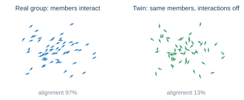
<figcaption><b>Figure 1.</b> The core comparison (schematic). Left: a real
group, whose members align with their neighbours. Right: its no-interaction
twin, the same members with interactions switched off. If both behave
alike at the group level, the interactions did not make the group's
behaviour.</figcaption>
</figure>

### 2.2 The interaction share

Pick a group-level quantity of interest, such as how aligned a school is,
the average price in a market, or the total activity of a brain area. Then
compare two forecasts of its next value:

* the forecast based on the **twin's law**, which describes how that quantity
  would evolve with no interaction;
* the forecast based on the **real law**, the best rule fitted to the real,
  interacting system.

The interaction share is

  **S = 1 − (error of the real law) / (error of the twin's law),**

with both errors measured on the real system.

| Value | Meaning |
| --- | --- |
| S ≈ 0 | The twin explains the group's behaviour; interactions added nothing to it |
| 0 < S < 1 | Interactions explain that fraction of what the twin gets wrong |
| S ≈ 1 | The behaviour exists only because the members interact |

S does not measure *how strongly* the parts interact. It measures how much
interaction has shaped the behaviour of the specific group quantity being
studied. Strong interactions can leave a quantity untouched: Section 3
shows an example.

### 2.3 The projected share for real data

With real data the twin cannot be observed directly; it has to be built
from a fitted model of each individual's own behaviour. Its forecast then
depends on the details of every individual, which no rule for the group
quantity alone can use. To compare like with like, the twin's forecasts are
summarised as a rule for the same group quantity (the twin's *projected
law*). The resulting **projected share**, S_proj, is exactly zero in
expectation when there is no interaction, and equals S whenever the twin's
law can already be written in terms of the group quantity. All real-data
results in this paper use S_proj.

## 3. Theoretical foundations

### 3.1 An exact answer on the reference system

Liardi et al. proposed walkers tied together by springs as a reference
system for measures of collective behaviour. On this system the interaction
share can be computed exactly, for every group quantity, spring strength,
group size and forecast horizon. Two findings stand out:

* **The average position scores exactly zero at any spring strength.** Each
  spring pulls equally in both directions, so the forces cancel in the
  average. Interaction exists, but it does not shape this quantity, and S
  correctly reports that.
* **The vibration patterns score higher as springs get stronger,** and
  short-wavelength patterns, which feel the springs most, score highest.

The established measure Ψ gets the ordering backwards. For the average
position it is highest when nothing interacts at all, and it becomes
negative as the springs get stronger, although the average's law does not
change.

<figure>
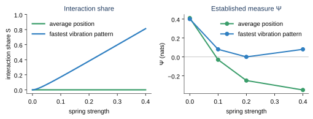
<figcaption><b>Figure 2.</b> Spring-coupled walkers (10 walkers, one-step
horizon). Left: the interaction share is exactly zero for the average
position and rises with spring strength for the fastest vibration pattern
(exact formula). Right: the established measure
Ψ is largest with no interaction and falls for the average position even
though its law never changes.</figcaption>
</figure>

All five pre-registered predictions for this comparison passed, and
simulation matched the exact formula to within 0.005.

### 3.2 A machine-checked general theorem

The zero for the average position does not depend on the springs being
linear. Using the Lean 4 proof assistant, we proved that for *any* pairwise
force obeying Newton's third law (every push has an equal and opposite
push back), the sum of positions follows exactly the no-interaction law.
We also proved the general principle behind it: if interactions never change
the next value of a group quantity, the twin's law is an exact law of the
real system, so nothing is left for interaction to explain. A
machine-checked proof removes any doubt about hidden algebraic errors.

## 4. Validation on simulated systems

Every test was **pre-registered**: the predictions and pass/fail thresholds
were written into the experiment code before it was run, and every outcome
is reported. Across these stress tests, **31 of 32 predictions passed.**

### 4.1 Can the twin be built from data alone?

In real systems interactions cannot be switched off, so the twin must be
estimated from recordings of the interacting group. We tested three ways to
do this on systems where the true answer is known.

| Way of building the twin | Outcome |
| --- | --- |
| Model each part's own behaviour plus interactions written in terms of *relative* position or state | Accurate (within 0.005 of the exact answer), even with short recordings or a wrong interaction network |
| Fit how behaviour changes with the number of neighbours, then extrapolate to zero neighbours | Accurate (within 0.004) |
| "Naive" twin: each part predicted from its own past only | **False positives**: the twin absorbs part of the interaction and inflates S |

With no interaction present, every method gave S ≈ 0 (no false alarms).
The lesson is that a twin must be built with an explicit model of what
interaction looks like; otherwise it quietly absorbs some of it.

### 4.2 Sudden collective order

Two classic systems show collective order appearing suddenly as coupling
grows: a magnet whose atoms line up below a critical temperature (the
Curie–Weiss and Ising models), and oscillators that fall into sync (the
Kuramoto model). In both, the interaction share rises from zero to nearly
one exactly where collective order appears. On the magnet, Ψ instead turns
strongly negative as interaction-made order grows.

<figure>
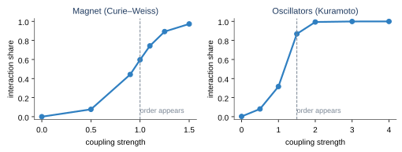
<figcaption><b>Figure 3.</b> Interaction share across two transitions to
collective order. Left: a mean-field magnet (exact values). Right:
oscillators with different natural frequencies falling into sync
(projected share, simulation). The dashed line marks where order
appears.</figcaption>
</figure>

### 4.3 A failure, and the fix

The one failed prediction came from the oscillators with different natural
frequencies. There, the twin's forecast depended on *which* oscillators
made up a fluctuation, fast or slow, and not just on the group quantity, so
the original comparison was unfair. With no coupling at all it gave
S = −0.06 instead of 0. The projected share (Section 2.3) was designed to fix
exactly this, and on retesting with fresh pre-registered predictions it
passed all six: S_proj = 0.003 with no coupling, rising to 0.999 when the
oscillators are synchronised.

## 5. Validation on real animal groups

### 5.1 Safeguards

Real data adds a risk that simulations do not have: the fitted model of
individual behaviour might simply be wrong. Four safeguards were used.

1. **Pre-registration.** Every round of analysis had its predictions fixed
   in advance, and every round is reported, including failures.
2. **Virtual groups (false-alarm check).** Each animal's real trajectory is
   shifted in time, so the animals share the same tank but never actually
   swam together. These groups should score about 0.
3. **Synthetic groups (known-answer check).** The fitted model is simulated
   with and without interaction, and the full pipeline is run on the result
   as if it were data. It must recover the known answer.
4. **Positive-control gate.** A recording counts only if the fitted model,
   when simulated, actually produces a cohesive interacting group.

### 5.2 Results

Two independent datasets were analysed with the same pipeline:

* **Adult fish** (Puy et al. 2024): eight recordings of 8 or 39 fish in a
  square tank, every fish tracked in every frame.
* **Juvenile zebrafish** (Heras et al. 2019): nine recordings of 60, 80 and
  100 fish in a circular arena, tracked with idtracker.ai (Romero-Ferrero et
  al. 2019).

The group quantity is the school's *polarisation*, how aligned the fish are.
Each fish's twin keeps its own wall avoidance and turning habits but drops
its responses to neighbours.

<figure>
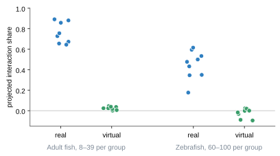
<figcaption><b>Figure 4.</b> Projected interaction share for every real
recording (blue) and its time-shifted virtual group (green), which shares
the environment but never interacted. Each point is one recording.</figcaption>
</figure>

| | Real groups | Virtual groups | Known-answer checks |
| --- | --- | --- | --- |
| Adult fish (8 recordings) | 0.64 to 0.89 | 0.00 to 0.05 | Synthetic loners −0.003; synthetic schools recovered exactly |
| Zebrafish (9 recordings) | 0.18 to 0.62 | −0.10 to 0.02 | Synthetic loners within 0.015 of 0; gate passed 9 of 9 |

Pre-registered predictions passed 7 of 7 on the adult fish and 6 of 8 on the
zebrafish. The two zebrafish misses were narrow: one recording exceeded its
virtual groups by 0.196 against a required 0.2, and one varied by 0.055
against an allowed 0.05. Lower values for juvenile zebrafish are consistent
with their looser, less aligned groups.

These values trained on the first 70% of each recording and tested on the
last 30%. A later check (Section 10.2) found that schools drift within a
recording, which makes a single split pessimistic. Cross-fitted over
interleaved blocks, the same twins give 0.72–0.91 for adult fish and
0.54–0.77 for zebrafish, with virtual groups still near zero.

Getting here took three rounds on the adult fish. The first two failed in
instructive ways, one because the twin ignored each fish's persistent
turning and one because the comparison was unfair (Section 4.3), and both
lessons are built into the final method.

### 5.3 Switching interaction off

Everything above is observational: the share was compared with groups that
never interacted, but nobody switched interaction off. Two public
experiments on rummy-nose tetras do exactly that, and we tested the share on
both with 15 pre-registered predictions. All 15 passed.

**Light and dark.** Liu and Burbano (2025) filmed pairs and triads in a lit
arena and in a dark one, where fish cannot see each other and only their
short-range flow sense remains. They also filmed single fish alone in each
condition. Single fish give two things no earlier dataset had: groups put
together from fish that were never in the same tank, and a twin built not
from a model but from how a fish actually swims when it is alone.

| Condition | Recordings | Share, twin from each fish's own past [90%] | Share, twin from fish recorded alone [90%] |
| --- | --- | --- | --- |
| Pairs, lit | 9 | 0.023 [0.019, 0.028] | 0.087 [0.055, 0.121] |
| Pairs, dark | 10 | −0.001 [−0.001, −0.000] | 0.027 [0.007, 0.050] |
| Triads, lit | 9 | 0.089 [0.076, 0.099] | 0.200 [0.134, 0.247] |
| Triads, dark | 10 | 0.001 [−0.001, 0.003] | 0.007 [0.001, 0.012] |
| Fish that never met | 40 groups | −0.003 to 0.001 | −0.001 to 0.038 |

In the dark the share falls to zero, the same as for fish that never met.
Every lit recording scores above every dark one. The twin built from fish
recorded alone gives the same contrast, and larger values, because it also
counts how a partner changes a fish's own swimming.

<figure>
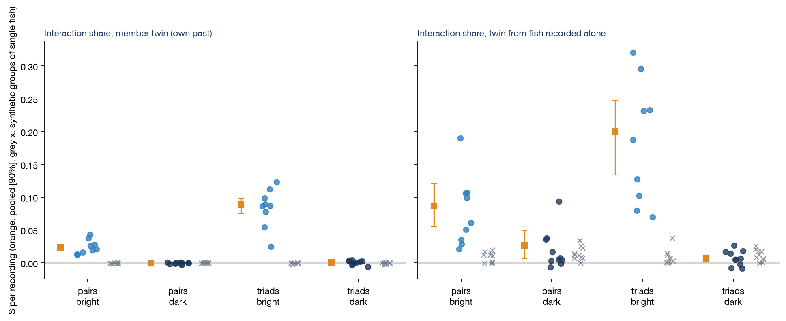
<figcaption><b>Figure 4b.</b> Interaction share of tetra pairs and triads in
a lit and a dark arena, per recording (dots), pooled with 90% intervals
(orange), and for groups of fish recorded alone (grey crosses). Left: twin
from each fish's own past. Right: twin from fish recorded alone.</figcaption>
</figure>

**A partner that responds, or ignores.** Escobedo and colleagues (2026)
let a real fish swim with a virtual one projected into its tank. In one
condition the virtual fish responds to the real fish; in another, the very
same virtual fish ignores it, so interaction runs one way only. Removing the
partner's response lowered the share from 0.063 [0.058, 0.066] to 0.019
[0.012, 0.025]. One-way interaction is still interaction, and the share
still sees it. Two real fish together scored 0.031.

<figure>
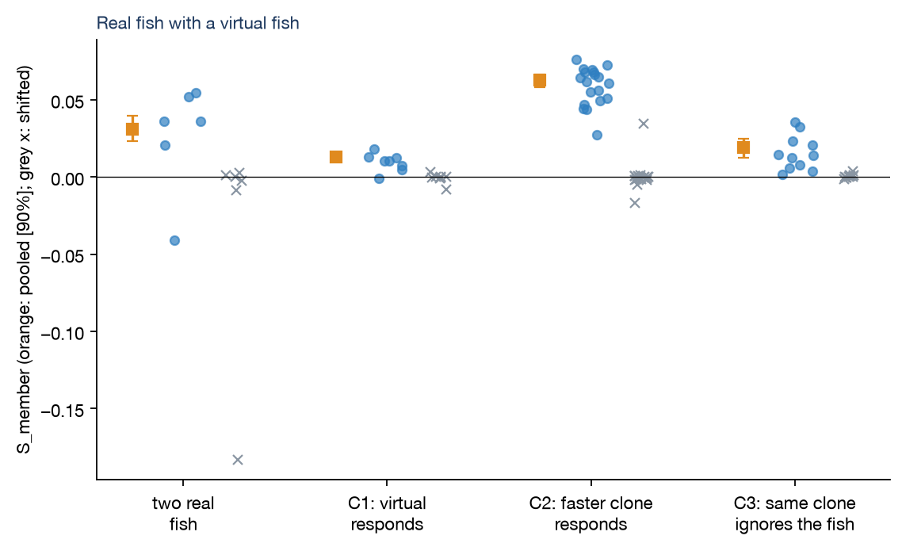
<figcaption><b>Figure 4c.</b> A real fish with a virtual fish that responds
to it (C1, C2) or the same virtual fish as C2 ignoring it (C3), and two real
fish (2R). Grey crosses: time-shifted groups that never interacted.</figcaption>
</figure>

The memory-gap equation (Section 10) matched the measured share within
0.01 in 37 of 38 tetra recordings. Two caveats remain. Darkness also changes
how a fish swims alone; the main twin is fitted within each condition, so
this does not enter the comparison. And the slower virtual fish (C1) scored
below the one-way condition, so the share depends on the partner's movement
as well as on whether it responds; only the C2–C3 comparison holds that
fixed.

**Large schools: no dose–response.** We then asked for a graded effect:
schools of about 50 tetras, each filmed for an hour at one of eight fixed
light levels from darkness to 900 lux (Lafoux et al. 2023). The tracker
follows each fish for only 4–80 s on average before giving it a new identity,
so we measured the share as its memory gap from short-lag statistics. We
checked this on simulated schools with tracks broken in the same way: it
recovered the true share within 0.011. The prediction that the share rises
with light failed (4 of 9 predictions passed). Every school scored 0.10–0.28,
darkness included (0.14 and 0.23), against at most 0.001 for the same tracks
shifted in time. Analyses after the run showed why the "off" condition was
not off:
- **Nearby fish still followed each other in the dark.** Their velocity
  correlation was 0.28–0.43 under one body length apart and about 0.2 at
  3–10, falling to zero beyond 20, close to the lit values.
- **Light changed the school's spread, not local coordination.** In the dark,
  9–30% of pairs of fish were over 20 body lengths apart, against 2–4% in the
  light.

Camera shake or water movement would move near and far fish alike; this
falls with distance, as interaction does. Lafoux's own measures (polarization,
milling) see only the school-wide order, which does need light. The share
measures any coordination that helps forecast the school, and in these
recordings that persisted in the dark. It may come from the lateral line, or
from residual light (darkness was 0 ± 0.1 lux from a projector). So these
recordings cannot test whether the share tracks how much fish interact.

## 6. Where the method did not work

GPS tracks of pigeon flocks (Nagy et al. 2013) were analysed in three
pre-registered rounds. Real flocks consistently scored 0.5 to 0.9 against
about 0 for virtual flocks, which is suggestive. But no model fitted to the
tracks, including one with the speed rule reported for pigeon pairs (Pettit
et al. 2013), could reproduce a cohesive flock: simulated flocks spread over
hundreds of metres while real birds stayed within about 8 metres. The
positive-control gate failed every time, so **no pigeon result is
claimed.**

This failure is informative. The interaction share is only as good as the
twin, and the twin is only as good as the model of individual behaviour.
The gate exists to catch exactly this case, and it did.

## 7. Is the group a level of its own?

The interaction share asks whether interactions *made* a group's
behaviour. A second question sits above it: is the group a *level of
description* in its own right? A level exists when the group's own variables
are enough to forecast its future, so that the members can be forgotten.
This is called closure (Bertschinger et al. 2006); it is how temperature and
pressure work for a gas. This section reports what we found when we asked that question
carefully, first on simulations with known answers, then on real animals.

### 7.1 Finding the levels instead of choosing them

Every earlier test *chose* the group quantity. We also built the reverse
procedure. Given only the members' trajectories and their twin, it ranks
every possible group variable from "made by interaction" to "untouched by
interaction" in one calculation. A level then shows up as a block of
variables, below a clear gap in that ranking, which forecasts itself. A
machine-checked proof (Lean 4) shows that closed levels stack: a closed
description of a closed description is a closed description of the parts.

On simulations with known structure, all 25 pre-registered predictions
passed. Without being told, the method found:

* the centre of mass of walkers tied by springs, and the
  correctly weighted average when coupling runs one way;
* the mean phase of synchronising oscillators;
* a three-level hierarchy (modules, groups of modules, the whole), built
  into 12 coupled units, in the spirit of Simon's (1962) nearly decomposable
  systems.

Two lessons carried forward. A level can be invisible one step ahead and
strongly interaction-made at its own, slower timescale. And the "obvious"
group averages are often not the closed ones.

### 7.2 A closure test that can be trusted

Applying this to real fish exposed a problem. Whether a group "looks
closed" depends on the forecaster used to check it. A forecaster that is
too simple calls everything closed. One that is too flexible overfits and
calls nothing closed (in one test, the group appeared up to 120% *worse*
predicted with more information). Neither verdict means anything.

We therefore built a closure test that must pass two checks of its own
before its answer counts:

* **Calibration.** A known, small signal (5% of the forecast error) is
  planted into the data. The test must find it.
* **Null control.** Information from a different recording, which cannot
  help, is offered. The test must decline it.

The forecaster is regularised, with its flexibility chosen by
cross-validation inside the training data. Its gap measure, G, is the
fraction of the group-level forecast error removed by also looking at the
members (0 = closed). The test found the planted signal in 21 of 24 checks.
In real schools the null control never exceeded 0.015. Two virtual groups
exceeded it, from an artefact in how virtual groups were built, which was
identified and removed in the next round.

### 7.3 Fish schools: self-contained in shape, open in direction

With this test, the six 8-fish schools of Puy et al. (2024) give a clear
split:

| What is forecast, 1 s ahead | Extra information from the members' arrangement |
| --- | --- |
| The school's shape (alignment, spread, milling) | At most 3% |
| Its motion (centre, mean heading, speed) | At most 2% |
| **Its next turn** | **6% to 21%, in every school** |

Three seconds ahead, even the turn is closed again. Earlier rounds had also
shown that the school is self-contained against the fish's individual habits
(the twin adds nothing to forecasting the school), while a single fish in a
school is not. Interaction moves the self-contained unit from the fish to
the school, but leaves the school's direction open for about a second.

These numbers come from testing on the last 30% of each recording. Because
some recordings drift (Section 10.2), we reran every closure and influence
experiment with the test moved to the first and to the middle 30% (all
fitting moved with it). The picture did not change: shape and motion stayed
closed, the turn stayed open (8–25%), and front fish steered in every
segment.

<figure>
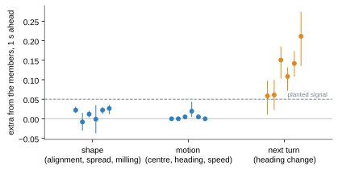
<figcaption><b>Figure 5.</b> How much the members' arrangement adds to
forecasting the school one second ahead, for each of six real 8-fish schools
(points with 95% intervals). Shape and motion are closed; the next turn is
not. The dashed line marks the planted signal the test is calibrated to
detect.</figcaption>
</figure>

### 7.4 Who steers: a learned influence map

To find *what* carries the turn, we let the data decide. For each fish,
the method learns how its position in the school, its heading, its own
turning and its speed predict the school's next turn, as a map over the
school. It assumes only that a mirrored left turn is a right turn.

The same map appeared in all six 8-fish schools and both 39-fish schools,
and in none of the virtual groups:

* **The front steers.** A fish at the front heading left of the school
  predicts a left turn. A fish at the back or sides doing the same predicts
  the opposite: it is a follower being pulled back into line.
* **Speed matters most.** A fast fish heading off the school's line predicts
  the turn far better than heading alone does (6–22% against 3–11%). A
  fish's own recent turning and its place alone add almost nothing.
* **It beats the hand-picked statistic.** The learned map outperformed a
  hand-designed leadership measure in every school (8–25% against 6–21%).

This is a rediscovery, not a new biological claim. Front fish and faster
fish are known to influence direction (Bumann and Krause 1993; Katz et al.
2011; Jolles et al. 2017), and Puy et al. themselves reported speed-induced
leadership in these schools. What is new is that a general closure test,
with no assumptions about fish, located the missing information and
identified the individuals who carry it.

<figure>
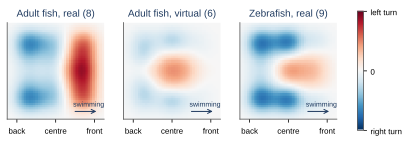
<figcaption><b>Figure 6.</b> Learned influence of a fish heading to the
left of its school on the school's next turn, by the fish's position in the
school (the school swims to the right). Red: predicts a left turn; blue: a
right turn. Each map is the average of all groups of that kind, each scaled
to a maximum of 1.</figcaption>
</figure>

### 7.5 Replication: partly

We reran the method unchanged on zebrafish groups of 60–100 (Heras et al.
2019) and on pigeon flocks (Nagy et al. 2013). Three of nine pre-registered
predictions passed, and one of those was trivially true.

* **Zebrafish: the structure replicates, its strength depends on when.**
  All nine groups show the same front-steers map, and speed carries the most
  information in eight of nine. Tested on the last 30% of each recording,
  the forecast gains were positive in every real group (2–13%) but confirmed
  in only three, and the planted-signal check failed in five groups. Tested
  on the first 30%, the gains were confirmed in eight of nine (3–19%) and the
  check passed. In the middle, two of nine. The ten-minute recordings drift,
  and the turning structure is strongest early in them.
* **Pigeons: closed for their turn.** A flock's own last second of
  turning already forecasts its next second so well that the birds' internal
  arrangement adds nothing measurable (G = 0.000). These flocks are very
  tightly aligned, and their GPS tracks are smoothed over 0.4 s. Known pigeon
  leader–follower delays are under 0.6 s (Nagy et al. 2013), so any steering
  shows up in the flock's own motion before one second has passed.

### 7.6 Where does a level stay open? Seven tests

The fish results suggested a tidy explanation. The variables in which the
school closed (shape, spread, speed) are *held in place* by interactions,
while its heading is *neutral*: every direction is equally good. Perhaps
levels are always self-contained in their stable variables and open along
their neutral directions. We tested this, and each idea that replaced it, in
seven pre-registered experiments. They were run on simulated flocks and
synchronized oscillators, where every rule is known, and on the real fish.

* **Pinning the direction (3 of 10 passed).** An external field pulled every
  member towards one direction, turning the group's heading from neutral into
  stable. In the flock, the field cut the heading's slow wandering fifteen-fold,
  yet the next turn stayed just as open (Figure 7, left). In the oscillators,
  the *stable* variable, synchrony, was the open one. **The
  stable-versus-neutral hypothesis is false in both systems.**
* **Free members (5 of 10).** What the open cases shared, after the fact,
  was a few members not locked to the group. Setting their number directly
  showed that in oscillators, a group with no free member is closed, and a
  single drifting oscillator out of 30 opens its synchrony to G ≈ 0.3, with
  the information sitting in that oscillator (Figure 7, centre). In flocks,
  privately informed members barely changed anything: their influence
  reached their neighbours within the forecast horizon.
* **Measured looseness (3 of 8, then 4 of 5).** We then stopped assigning
  freedom and measured it: a member's *looseness* is how weakly its heading
  or phase tracks the group's. In 30 random oscillator groups, every group
  whose members were all locked was closed. Every group with a measurably
  loose member was open, and its 3 loosest members carried more information
  than its 3 tightest in 21 of 21 cases (Figure 7, right). The relation is a
  threshold, not a slope. In random flocks and in the 15 real fish groups,
  no member is loose in heading, and the loosest members carried no more than
  the tightest (9 of 15 fish groups).
* **Momentary innovations (4 of 9).** Perhaps freedom in a flock is
  momentary: a member briefly turns in a way its neighbours do not explain.
  This measure identified every privately informed agent perfectly (24 of 24
  flocks). Yet those innovations carried little of the flock's openness. In
  adult fish they carried a real share, 23–64%; in zebrafish, none.
* **A slow internal state (2 of 6, then 1 of 7).** Finally, a unifying
  idea, Haken's slaving principle read as a test: perhaps a level is open
  whenever some part of its internal state is slow, persisting over the
  forecast horizon. Measured either by its dominant fluctuations or by its
  slowest directions, this failed. Every group has slow internal directions,
  closed groups included. The fast internal directions never carried any
  information.

<figure>
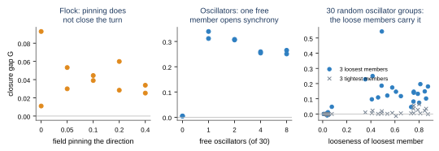
<figcaption><b>Figure 7.</b> Testing where a level stays open. Left: in a
simulated flock, pinning the group's direction with an external field does
not close its next turn. Centre: in 30 synchronized oscillators, one free
member is enough to open the group's synchrony. Right: in 30 random
oscillator groups, groups whose loosest member is tightly locked are closed;
otherwise the information sits in the loosest members (blue), not the
tightest (grey).</figcaption>
</figure>

### 7.7 What this suggests now

The tidy rule did not survive, and neither did any of its successors as a
general law. What did survive splits by kind of system:

* **Oscillator-like groups, where a member is either locked or not.** A
  group is open exactly when some members are measurably loose, and the
  inside information is in those members. Openness can then be read from
  the data by finding the loose members.
* **Flocks and fish schools, where alignment is graded and contagious.** No
  member is loose. The inside information is carried by small, short-lived
  differences spread over many members, in speed, position and momentary
  heading. Our influence maps describe *where in the school* this
  information sits (front, fast), not *which individuals* are free.

The common thread is negative, but useful. **Whether a level is open is not
a property of its internal dynamics alone.** It depends on whether some
persistent internal state is *coupled* to the group variable in question,
and that coupling is exactly what the calibrated closure test measures. In
oscillators, looseness happens to identify the coupled members. In flocks
and fish, no simple property we tried does. There is, so far, no shortcut
around the closure test itself.

## 8. A new domain: neurons and brain areas

Everything so far concerned animal groups. To test whether the method
transfers, we applied both tools to a completely different layer: single
neurons (the members) and the activity of the brain area they belong to (the
group). The data are the public Neuropixels recordings of Steinmetz and
colleagues: 39 sessions of mice performing a visual choice task, giving 221
brain areas with at least 30 active neurons each.

### 8.1 How the method maps onto neurons

| Concept | In the brain data |
| --- | --- |
| Member | One neuron's spike train, in 10 ms bins |
| Group quantity | The area's total spike count over the next 50 ms |
| Twin | One model per neuron, using its own recent spiking and the recorded causes, with no other neuron |
| Recorded causes | The stimulus; then task events, behaviour (wheel, pupil, face, licking) and time in the session; then the activity of every other recorded area |
| Virtual group | Each neuron's trials shuffled among trials with the same stimulus, so its stimulus responses are kept but its moment-to-moment coordination with the others is broken |

Before trusting real data, we ran the method on simulated spiking networks
with known answers. The first attempt failed its own checks. A numerical
fault in the per-neuron models made virtual groups score as high as real
ones. We recorded that as a failure, fixed the fault, and pre-registered the
analysis again.

### 8.2 What the simulations show

The simulations set the scale for everything that follows:

* **Independent neurons score 0**, and so do virtual groups.
* **Realistic neuron-to-neuron coupling is detected, but it is small.**
  Coupling that produces the weak pairwise correlations typical of cortex
  gives a share of 0.01 to 0.05. Weaker random coupling barely shapes the
  population total at all: the springs lesson of Section 3 again.
* **A shared input that nobody recorded is flagged as interaction,** and it
  is about ten times larger (around 0.35). Once that input is recorded, the
  share falls to 0.

The last point is the method's main limit on this layer. Coordination
*beyond the recorded causes* can come from the neurons' interactions or from
a common input that was not measured. The interaction share alone cannot
tell these apart.

### 8.3 Results: brain areas are close to closed

<figure>
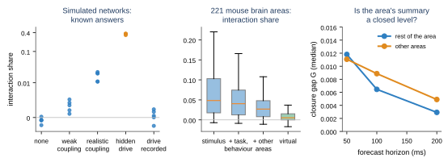
<figcaption><b>Figure 8.</b> Left: simulated networks with known answers.
Realistic coupling gives a small share; an unrecorded shared input (orange)
gives a large one. Middle: the interaction share of 221 mouse brain areas,
as more recorded causes are accounted for, and of virtual groups. Right:
how much the rest of the area, or other areas, add to forecasting the
area's summary state, by horizon.</figcaption>
</figure>

| Measure, median over 221 areas | Value |
| --- | --- |
| Interaction share beyond the stimulus | 0.048 |
| ... beyond the stimulus, task, behaviour and session drift | 0.040 |
| ... beyond all of these and every other recorded area | 0.027 (positive in 80% of areas) |
| Virtual groups | 0.005 |
| Closure gap of the area's summary state, from the rest of the area, 50 / 200 ms | 0.012 / 0.003 |
| Closure gap from other areas, 50 / 200 ms | 0.011 / 0.005 |

* **About 3% of what a no-interaction model gets wrong** about an area's
  next 50 ms is explained by coordination beyond every recorded cause. The
  simulations put this within the range of realistic coupling, but an
  unrecorded common input could produce it too. It is therefore best read
  as an upper bound on what local interaction contributes.
* **An area's three-dimensional summary is almost a closed level.** With
  its recorded causes, it forecasts itself nearly as well as the full
  population does: the rest of the area adds about 1% at 50 ms and 0.3% at
  200 ms, and other areas add about as much.
* **Areas differ.** Hippocampus shows no interaction share and is closed
  inside, but leans on other areas. Frontal and limbic areas are the most
  open to other areas, and sensory thalamus and basal ganglia the least.
* **The calibration held.** Null inputs scored exactly 0 in all 221 areas.
  A planted 5% signal was detected in 218, though in a fifth of the areas
  less than half of it was recovered.

Of 28 pre-registered predictions across the three neural experiments, 16
passed, including 4 of 9 in the failed first attempt. The other failures were thresholds set too high for realistic coupling,
a leak of unrecorded shared input into the virtual control, and a weaker
than predicted link between interaction and openness.

**What this means.** The method transferred to a new domain with its checks
intact. Its answer is that, at the scale of tens of milliseconds, a mouse
brain area behaves mostly as a closed level driven by its recorded causes.
At most a few percent of its activity is shaped by coordination among its
own neurons. That fits the view that population activity at this scale is
largely driven from outside the local circuit.

### 8.4 Switching off an input

Coordination beyond the recorded causes can be local interaction or an
input nobody recorded. A perturbation can separate the two: switch off a
major input, and see whether the coordination goes with it. Inagaki, Chen
and colleagues (2022) recorded the motor cortex of mice (ALM) while
optogenetically silencing the midbrain region that drives it through the
thalamus. That gave 21 sessions with enough neurons and silenced trials.

The first pre-registered attempt failed its own calibration (2 of 8). Its
test window straddled the go cue, whose large, time-locked response,
estimated from only about 40 silenced trials, looked like a shared input
even in simulated networks with no coordination at all. Its real-data
numbers were therefore declared void. A redesign was developed on
simulations alone. It used the steady delay period while the light was on,
before the cue, and simpler, linear models of each neuron. It was then
pre-registered on fresh simulations and the real data (4 of 7 passed):

| Interaction share, before the cue | Control trials | Input silenced |
| --- | --- | --- |
| Simulated independent neurons | −0.02 | −0.01 |
| Simulated network driven by an input, which silencing removes | +0.30 | −0.02 |
| Motor cortex, median of 21 sessions | +0.001 | −0.012 (median change 0.000) |

The redesigned test was calibrated, and it caught a simulated input being
switched off every time. In the real motor cortex there was no
coordination to remove, and silencing did not change it. The
pre-registered difference-in-differences did pass (p = 0.013), but for the
wrong reason. The whole difference lay in the period *before* the light,
where the trials later chosen for silencing happened to score higher, so
the pass is not counted as evidence. The honest reading is that, during
the delay, motor cortex shows no coordination this test can resolve at
about 40 trials per condition (about ±0.03 per session). Whether the few
percent found in Section 8.3 is local or inherited from upstream remains
open. Settling it
needs about 100 or more silenced trials in a steady period.

A later, exploratory check used all ~270 control trials per session rather
than 40 (Section 10.4). At that sample size, motor cortex in the 1.5 s
before the cue does show a small share: a median of 1.4%, positive in 19 of
21 sessions, predicted by the memory-gap equation of Section 10 (1.7%,
rank correlation 0.94).

**Confirmation on unseen sessions (9 of 10 pre-registered predictions
passed).** The same analysis was then pre-registered on the 19 sessions of
the dataset that had never been analysed, because they had too few silenced
trials for the perturbation study:

| Unseen sessions (19) | Median | Positive |
| --- | --- | --- |
| Measured share | 1.3% | 16 of 19 |
| Predicted by the memory gap | 1.6% (rank correlation 0.86) | |
| After removing slow drift over the session | 1.4% | 17 of 19 |
| Virtual groups (trials shuffled per neuron) | −0.2% | 1 of 19 |

So, in the second before movement, about 1.3% of motor cortex's next 50 ms
is predictable from the area's own history beyond what each neuron's own
history and instructed side give. This is the size Section 8.3 found across
brain areas.

The same experiment asked again whether this share needs the midbrain
input, this time with the memory gap, which needs no fitting and so avoids
the twins' noise. On simulations the test caught an input being switched
off every time and left coupled networks alone. At the real share's size,
though, it had only marginal power. In motor cortex the change with
silencing was +0.2% (10 of 21 sessions lower). By the reading fixed in
advance, that is inconclusive, not evidence of independence. The question
needs more silenced trials, not a better method.

**Replication in a second laboratory (7 of 7 pre-registered predictions
passed).** We searched the public archive for a dataset with enough silenced
trials. None has them:

* in one, silencing the thalamus shuts motor cortex down;
* another records too few neurons per session;
* the largest has no silencing at all.

That last one (Economo et al., 2018) is still useful. It is 19 sessions
recorded with a different task, set-up and probes, never analysed before.
The same pre-registered analysis gave:

| Second laboratory, 19 sessions | Median | Positive |
| --- | --- | --- |
| Measured share | 2.6% | 19 of 19 |
| Predicted by the memory gap | 2.9% (rank correlation 0.95) | |
| After removing slow drift over the session | 2.5% | 19 of 19 |
| Virtual groups | −0.2% | 1 of 19 |

The small coordination share before movement is therefore a property of
motor cortex, not of one dataset, and the memory gap again ranks the
sessions almost perfectly.

The same experiment worked out what a decisive silencing test would need.
In simulated networks with an input of motor cortex's size, a 21-session
experiment detects its removal with probability 0.74 at 40 silenced trials
per session and 1.0 at 80, with false alarms near 2%. Real sessions are 1.4
to 2.5 times noisier than the simulations. So a decisive experiment needs
roughly **100 to 300 silenced trials per session**, against the 24 to 59 that
exist. This is a design for a new experiment, not a question public data can
answer.

## 9. A third domain: markets

Markets are where the question "coordination or common cause?" is most
often asked: are investors herding, or all reacting to the same news? We
took the interaction share there with the same safeguards.

| Concept | In the market data |
| --- | --- |
| Member | One of Kenneth French's 49 US industry portfolios; its daily absolute return as a measure of volatility |
| Group quantity | The market's volatility: the mean over industries, 13,801 trading days (1972–2026) |
| Twin | Each industry's standard volatility forecast from its own past day, week and month (HAR; Corsi 2009), plus the day of the week |
| Virtual group | Each industry shifted in time by its own random offset, keeping its dynamics but breaking the alignment |
| Known answers | Simulated markets of 49 GARCH members: independent; correlated shocks; volatility spillover; a common volatility driver |

**The simulations taught something new about the method.** Independent
markets and markets whose returns merely move together both score 0.
Volatility spillover, where each member responds to *other* members'
shocks, is detected (0.02 to 0.04). But a common volatility driver is
**not** counted, even a strong one. Every member's own history already
reveals the shared state, so every twin learns it. This was found during
development, then pre-registered and confirmed. It refines the brain
result: a common input is flagged only to the extent that members' own
histories reveal it poorly. Noisy spike counts reveal a shared drive
poorly, so neurons were flagged. Volatility reveals it well.

<figure>
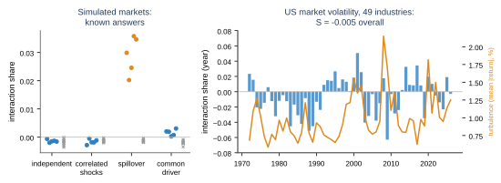
<figcaption><b>Figure 9.</b> Left: simulated markets with known answers
(grey crosses: virtual groups). Only spillover between members is counted.
Right: the interaction share of US market volatility in each year since
1972 (bars), with the market's turbulence (line).</figcaption>
</figure>

**Results (6 of 10 pre-registered predictions passed).** The market scores
S = −0.005 (90% interval −0.011 to +0.002), with clean virtual groups. It
scores no higher in either half of the period (−0.014 and 0.000), and no
higher in turbulent years: 1987, 2008 and 2020 score −0.01, +0.02 and
+0.02 (rank correlation with turbulence 0.12). All five simulation checks
passed. A replication on 467 individual stocks (2013–2018) is void: with
only five years, the time shifts were too short to break the stocks'
shared episodes, and their virtual groups scored about 0.5.

**First reading.** Most of the market's volatility is a common driver that
each industry already carries, and on raw volatility the market's past adds
nothing beyond each industry's own past. That reading was revised by the
next test.

### 9.1 A second look, pre-registered on unseen data

The equation of Section 10, applied to the same data, predicted a share of
+0.016 where +0.000 was measured. The miss had a clear cause. In raw
absolute returns, a handful of crash days dominate every forecast error, so
the measured share is set by a few days. On the logarithm of volatility, the
standard choice in finance, the measured share was +0.013, close to the
prediction. That was found after the fact, so it was tested as a new,
pre-registered prediction on data never analysed before: 40 industries from
1936 to 1971.

| Data | Log volatility: S [90% interval] | Predicted by the equation | Raw volatility |
| --- | --- | --- | --- |
| **40 industries, 1936–1971 (unseen)** | **+0.029 [+0.017, +0.041]** | +0.028 | +0.012 |
| 49 industries, equal-weighted, 1972–2026 | +0.017 [+0.010, +0.024] | +0.019 | −0.003 |
| 49 industries, value-weighted, 1972–2026 | +0.013 [+0.006, +0.020] | +0.015 | −0.005 |

All 5 predictions passed, and the virtual groups stayed within ±0.004.
These measured shares are slightly too low because of a leak in the
measurement, found later (Section 10.2). Leak-free, the unseen 1936–1971
share is 0.031 against 0.028 predicted, and equal-weighted 1972–2026 is
0.019 against 0.019.

**What this means.** US market volatility is mostly a common driver that
each industry carries, but not entirely. Knowing the market's own history
improves a forecast of tomorrow's market volatility by 1.9–3.2% beyond all
industries' own histories (leak-corrected), and the equation predicted the
size in advance. Whether that few percent is spillover between industries or
a slow shared driver that each industry reveals poorly, the share alone
cannot say (Section 10.3).

### 9.2 Individual firms in eight markets

A portfolio averages away most of each firm's own noise, so its history
reveals the market's state almost as well as the market's own history does.
By the simulations above, that should hide coordination, and individual firms
should show more of it. The first stock test (five years of S&P 500 stocks)
was void because the series were too short. We repeated it with 27 years of
daily prices (2000–2026) for today's members of eight indices, using the
leak-free measurement and the same pipeline:

| Market | Firms | Share, firms [90%] | Predicted by the equation | Portfolios of the region |
| --- | --- | --- | --- | --- |
| US (S&P 100) | 40 | 5.6% [3.4, 7.8] | 5.2% | 2.6% |
| Canada (S&P/TSX 60) | 36 | 7.9% [3.4, 11.7] | 7.0% | — |
| UK (FTSE 100) | 40 | 4.5% [2.8, 5.9] | 3.8% | 0.2% (Europe) |
| France (CAC 40) | 29 | 2.8% [1.6, 3.9] | 2.5% | 0.2% (Europe) |
| Germany (DAX) | 25 | 2.3% [1.2, 3.4] | 2.1% | 0.2% (Europe) |
| Australia (S&P/ASX 50) | 31 | 4.5% [1.9, 7.4] | 3.9% | 1.3% (Asia Pacific) |
| Japan (Nikkei 225) | 40 | 1.5% [0.5, 2.9] | 1.5% | 0.3% |
| Hong Kong (Hang Seng) | 17 | 0.8% [−0.1, 2.2] | 0.8% | 1.3% (Asia Pacific) |

Eight of nine pre-registered predictions passed (the miss was a simulation
tolerance). Virtual groups stayed within ±0.4%. Firms coordinate more than
portfolios in six of seven comparisons. In Europe the difference is a factor
of 10 to 20. The equation, with no model fitted, came within 0.8 percentage
points of every measured share and ordered the eight markets exactly. In its
terms, a firm's volatility forgets faster than its market's. The firms are
survivors (today's index members with a full history), and the share does
not say whether the shared part is spillover between firms or a common
driver each reveals poorly. What it does say is how much a firm-by-firm
volatility forecast misses about the market. That firms show more than
portfolios is what aggregation theory leads one to expect (Granger 1987), and
fits a persistent volatility component shared across assets (Bollerslev et
al. 2018). The new part is that the equation gets the size right in every
market.

### 9.3 Against the standard spillover index

The usual measure of connectedness in finance is the Diebold–Yilmaz total
spillover index (Diebold & Yilmaz 2012): fit a vector autoregression to the
members and report how much of each one's forecast error comes from the
others' shocks. We compared it with the share (as its memory gap) on simulated
markets with known answers and on the eight stock markets above, in rolling
500-day windows stepped monthly. Seven of ten pre-registered predictions
passed.

| Simulated market (40 members) | Share | Diebold–Yilmaz |
| --- | --- | --- |
| Independent | 0.000–0.001 | 0.7% |
| Hit by the same shocks at the same moment, no spillover | 0.001–0.003 | 44–46% |
| Volatility spills from member to member | **0.022–0.028** | **0.6%** |
| A common volatility factor | 0.009–0.010 | 71–74% |

**The two see opposite things.** Diebold–Yilmaz registers members being hit
together and misses spillover through time, at any lag order we tried. The
share does the reverse. In 500-day windows the index reads 16% for
independent firms and cannot tell spillover from independence. The share is
also biased up in short windows but keeps the two apart. With 400 firms it is
20 times faster (3 ms against 66 ms per window).

**Neither forecasts market volatility.** On real markets, adding the share to
a standard volatility forecast (HAR) that already has the index helped in one
market of eight. Adding the index to HAR plus the share helped in two. Both
predictions failed.

**A forecast that did not replicate.** Adding the share to HAR plus the
index improved forecasts of next month's correlation between firms in all
eight markets, with an unpredicted sign: a higher share was followed by
*lower* correlation. We tested this again (e82). Most of the gain came from a
missing control, the current correlation between firms, which is persistent.
On six markets never used before (Sweden, India, Korea, New Zealand, Brazil,
and S&P 500 firms outside the S&P 100), with the direction fixed in advance,
adding the share helped in two of six with the control and in two of six
without it. Two of six predictions passed. A small negative association
survives when the markets are pooled (and not for a placebo), but it is no
forecasting tool.

The two measures disagree, often strongly. Across windows their correlation
ranges from −0.82 (Japan) to +0.64 (Canada). So the honest answer to "why
yours rather than the standard?" is: it is not a better forecaster, of
volatility or of correlation, but it measures a different thing. It sees the spillover the
standard index misses, and ignores the simultaneous shocks the index mostly
counts. One caveat favours the index: Diebold and Yilmaz used intraday range
volatility, while we used daily absolute returns for both.

## 10. One equation across domains: the memory gap

The results so far follow a pattern. The share was high wherever the group's
past revealed something no member's own past did (fish schools; neurons
with a hidden drive). It was near zero where every member already carried
the shared signal (market volatility). This can be made exact.

### 10.1 The equation

Call a member's **memory** how its present resembles its own past (its
autocorrelation over time), averaged over members. Call the **group's
memory** the same for the group total. A twin that forecasts each member
from its own past uses the members' memory. Added up over members, it
forecasts the group with *their* memory, while the group's own law uses
the group's memory. The interaction share is the cost of that mismatch:

S = 1 − (error of the best forecast using the group's memory) / (error when the group is forecast with its members' memory).

With a single time lag it has a simple closed form. With ρ_m the members'
and ρ_g the group's one-step autocorrelation:

S₁ = (ρ_g − ρ_m)² / (1 − 2 ρ_m ρ_g + ρ_m²).

The share is zero when the group remembers the way its members do, however
correlated they are. It is large when the group remembers longer than its
members. Two things make that happen. Coupling feeds the group's past back
into every member. A persistent shared signal that is spread thinly over
many members is barely visible in any one member but clear in the total.
The second gives a **pooling peak**: for a given group size, a shared input
counts most at an intermediate strength. Larger groups peak higher, and at
weaker per-member signals.

**Where this comes from.** The comparison itself is not new. Economists have
long asked when a total (national output, a price index) is best forecast
from its own past and when from its parts (Kohn 1982; Lütkepohl 1987), and
the answer depends on exactly these two memories. Granger (1987) showed that
a common factor weak in each part can dominate the total, which is the
pooling peak in other words. Physics has a counterpart: a liquid's collective
correlations split into each particle's correlation with itself and the
correlations between particles (Van Hove 1954). What is new here is the
reading. If members did not interact or share inputs, the group's memory
would be exactly the sum of its members', so the gap measures what
interaction leaves behind. As far as we found, the emergence and aggregation
literatures have not been connected before.

### 10.2 Tests in four domains

<figure>
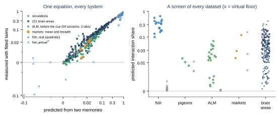
<figcaption><b>Figure 10.</b> Left: the share predicted from two memory
curves against the share measured with fitted twins, for every system. The
dashed line is equality. Fish use the quadratic form (triangles: real
schools; crosses: virtual groups). Motor cortex includes the 19 unseen
sessions and 19 from a second laboratory; markets include breadth, the
fraction of industries having an extreme day. Right: the equation as a
screen on every dataset,
with each dataset's virtual floor (grey crosses) as first computed; the
market and pigeon floors are lower with whole-record shifts (Section 10.4).</figcaption>
</figure>

* **Simulations and brain areas (8 predictions, 7 passed).** In 66
  simulated systems the equation matched the measured share: common input,
  all-to-all and local coupling, volatility models, and spiking networks.
  In 221 mouse brain areas it matched with rank correlation 0.97 (median gap
  0.006). It also reproduced the earlier nonlinear twin results (0.93).
  The miss was raw market volatility (Section 9.1).
* **Markets (5 of 5).** The equation predicted the share in 36 unseen
  years of data before it was measured (Section 9.1).
* **Fish schools (3 of 4).** Here the measured shares come from nonlinear
  twins and from polarization, a nonlinear group variable. Given only each
  fish's heading memory and the school's, the equation put all 17 virtual
  groups at zero and all 17 real schools above them, and ranked the 34
  groups (0.76). Within real schools it ranked them the wrong way (−0.65).
  It tells whether a school coordinates, not how much of its polarization
  is interaction-made.
* **Fish schools, quadratic form (6 of 6).** The diagnosis was that the
  linear equation ignores the *level* of polarization. A twin of
  independent fish predicts that a tightly aligned school drifts towards
  disorder, and that error is most of the measured share. Polarization
  squared is a sum over pairs of fish, so the twin's forecast of it is exact
  given each fish's own memory forecast:
  (N + |Σ mᵢ|² − Σ |mᵢ|²) / N². With nothing else changed, the quadratic
  memory gap ranks the real schools correctly (rank correlation +0.86, from
  −0.65). It puts virtual groups at zero and is within 0.14 (median) of the
  fully modelled shares (Figure 10, triangles). The same construction works
  for any group variable that is quadratic in the members, such as
  alignment, synchrony or energy.
* **Why it ran above the full twins (9 of 10).** We expected the full twins
  to explain more, through walls and persistent turning. That turned out
  to be a small part of the difference. Scoring both twins on the same
  target with the same cross-fitting split e72's 0.14 excess into three
  medians, which don't add exactly: 0.068 from the published shares'
  single 70/30 split, which schools drifting within a recording make
  pessimistic; 0.016 from the different target; and only 0.031 from what
  the full twin knows. Under the same fitting, the full twin is 0.015–0.076
  below the memory gap in every school (rank correlation 0.98). In
  simulation the memory gap was never more than 0.03 above the true twin.
  It fell far below the true twin when fish locked onto the school's
  heading, because then each fish's own past already carries the group's.
* **Any group variable, sums (10 of 10 with the next item; refined by a
  follow-up, 5 of 10).** A variable
  that adds up some function of each member, such as the fraction of
  industries having an extreme day ("breadth"), is just the linear equation
  applied to that function of the members. This held in 40 of 40 simulated
  markets, and on 36 unseen years the breadth share was 2.2% against 2.4%
  predicted.
* **Any group variable, the rest.** A variable that does not add up, such
  as the *worst* industry, also depends on how members move together on the
  same day, which no member's history shows. Its twin is simulated: each
  industry's own forecast plus an independent draw of its own past
  surprises. A second, "joint" twin draws all industries' surprises from the
  same past day. That keeps their same-day dependence, so the share against
  it is the dynamic part alone.

In simulations this split works as designed. Shocks that hit all
industries on the same day show up only in the worst industry (0.16 to
0.42) and vanish against the joint twin. Real spillover shows up
everywhere. We had registered a hypothesis that extremes carry extra
coordination ("contagion"). It passed by 0.001 on the primary data and
reversed in both other datasets, so we count it as unsupported.

That first simulated twin was approximate: it read about 0.02 even for
independent markets, so its shares had to be corrected against virtual
groups. A follow-up built an **exact** one by modelling each industry where
its randomness lives. The twin estimates each industry's volatility from its
own past returns and rebuilds each day from that industry's own
standardized shocks. It reads zero for independent markets and for virtual
groups with nothing subtracted (5 of 5 simulation predictions).

With it, the worst industry's share in real markets is 0.16 to 0.22 over
1936–2026, almost all of it same-day co-movement. "Systemic days", when a
fifth of industries are extreme at once, carry a share of 3 to 5%. The
real-data predictions of that follow-up, though, all failed (0 of 5):

* on the never-analysed 1926–1935 data, 2,800 days were too few to see
  systemic days at all;
* breadth missed its prediction there by 0.03.

**A leak, found and fixed.** Breadth's misses were not the equation's. The
cross-fitted measurement fitted its last stage on twin forecasts from member
models that had already seen the test days. That makes the twin look better
than it is, so the measured share comes out too low. The fix fits every
stage without the test days. A pre-registered audit (10 of 12 predictions
passed) found:

* **In simulated markets** the leak lowered the share in 39 of 40 cases.
  Leak-free, independent markets read zero, and the share matched the
  memory gap within 0.003 everywhere.
* **In real markets** the bias was 0.001 to 0.005 for the average and up to
  0.024 for breadth. Leak-free, breadth matches its prediction on every US
  dataset (for example, 1972–2026: 1.5% against 1.6%). For sums of any
  member function, the memory gap is an estimate, including for rare events.
* **On three never-analysed markets** (Japan, Europe and Asia Pacific,
  1990–2026) the equation predicted the leak-free share within 0.004 for
  both the average and breadth, with clean virtual groups. Coordination is
  small in Japan and Europe (0.2%) and larger in Asia Pacific (1.2%). We had
  predicted at least 0.5% in two of the three regions, which failed. The
  equation itself got all three sizes right.
* **Brain areas, motor cortex and the equation's simulations** barely moved
  (median change +0.0005), so none of those results change. The one miss:
  removing the leak did not bring brain areas closer to the equation.

### 10.3 What no such measure can see

The equation depends only on how members and group remember, that is, on
second-order statistics. So a common input and coupling between members
that produce the same memories give the same share. This was confirmed in
simulation. It is not a weakness of this method in particular, but a limit
of any measure built from linear forecasts. Telling them apart requires
recording the input or intervening on it (Section 8.4).

### 10.4 A screening tool

Because it needs no model of the members, the equation is a cheap screen.
From members' time series, the tool returns the predicted share, the two
memories, and a virtual floor: the same value for members shifted in time,
or for trials shuffled across members. Applied to every dataset in this
project (exploratory, Figure 10, right):

* **Fish schools:** 0.10 to 0.64, floors at 0.
* **Motor cortex before movement:** a median of 0.017, floors at 0. The
  full measurement on the same trials confirmed it (0.014, rank
  correlation 0.94), and a pre-registered test on 19 unseen sessions
  confirmed it again (Section 8.4).
* **Pigeon flocks:** faint, about 0.01. At one second, each bird's own
  smoothed heading already forecasts the flock almost entirely, as the full
  analysis found.
* **Markets:** small positive values for industries (0.015 and 0.028), and
  0.117 for five years of individual stocks. The screen flags candidates; a
  cross-fitted measurement must decide.

Building the tool also caught three mistakes before any number was reported.
A fourth was found later, while packaging the method for general use. The
floor's time shifts were drawn from the middle half of the record, which
moves every member by about half its length and keeps slow regimes aligned.
That made the market floors look high (up to 0.15 for stocks). Shifts spread
over the whole record bring them under 0.01.
An estimator gave impossible values on very smooth tracks. A time-shift
floor kept trial-wide shared fluctuations. A preprocessing bug inflated the
motor cortex value, and checking it against the full method exposed the bug.
They show what the screen is good for: a fast first look, with the
full method as the arbiter.

### 10.5 Testing the extremes

Six further experiments (e84–e89) took the equation where the answer is
known in advance, or where it might fail. Each was developed on one part of
the data, frozen by hash, and run once on untouched data.

* **A magnet at its phase transition (4 of 5).** In the Ising model, spins
  are members and the magnetization is the group. The share is near zero
  when the magnet is frozen (0.08) and when it is too hot for spins to
  interact (0.05), and peaks at the transition. The peak sharpens with
  size (0.68, 0.79 and 0.89 for 16×16, 32×32 and 64×64 lattices) and moves
  towards the exact critical temperature (2.50, 2.35, 2.30 against
  Onsager's 2.269; Onsager 1944),
  just as the textbook marker of the transition does. One control failed:
  right at the transition, time-shifted lattices read up to 0.094, because
  a large lattice there relaxes too slowly for the recording to contain
  many independent swings.
* **Groups from 2 to 10,000 (6 of 6).** One alignment rule at every size.
  The share rises steeply up to about 30 agents and then levels off (about
  0.52 when everyone sees everyone, 0.36–0.40 with local neighbours). For the
  everyone-sees-everyone case it has an exact formula, and the measurement
  matched it within 0.011 at every size. The share describes the
  interaction rule, not the size of the group.
* **Time run backwards (5 of 5).** The memory gap is identical forwards and
  backwards (a theorem: memories read the same both ways), and the measured
  share nearly so (within 0.006). The share says *how much* coordination
  there is, not its direction. The influence measure does see direction: a
  leader's influence is 0.62 forwards and 0.06 backwards, while a hidden
  common driver shows no leader either way.
* **A flawed random-number generator (5 of 5).** RANDU, an IBM generator of
  the 1960s, puts all its outputs on 15 planes in three dimensions
  (Marsaglia 1968). The
  share is blind to it, because the flaw is modular arithmetic with no
  linear correlation; a classical uniformity test rejects it outright. A
  planted leak between streams shows the reverse: the share catches it and
  the classical test does not. Two tools with different blind spots.
* **Prime numbers (9 of 9, then 8 of 8).** Could memory tell a search where
  primes are? Prime counts in blocks of the number line do carry real
  memory beyond divisibility (a rich block tends to be followed by a poorer
  one, as number theory predicts; Montgomery and Soundararajan 2004), and
  the equation found it blind. But it
  saves at most 0.3% of primality tests, against 47% for one more
  divisibility filter, and with every standard filter applied first nothing
  is left (numbers up to 10¹⁸).

<figure>
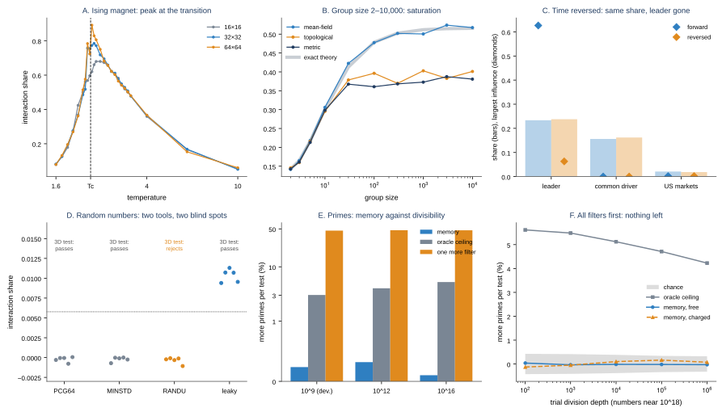
<figcaption><b>Figure 11.</b> A: the share of an Ising magnet against
temperature for three lattice sizes (dashed: exact critical temperature).
B: the share against group size for three neighbourhood rules, with the
exact mean-field theory (grey). C: share (bars) and largest member
influence (diamonds) forwards and backwards in time. D: the share for four
random-number generators (five seeds each; dotted: no-coordination bar),
with the verdict of a classical 3D uniformity test. E: extra primes per
primality test from memory, from perfect knowledge of every block, and
from one more divisibility filter. F: memory's gain at each filter depth,
with free or charged information, near 10¹⁸.</figcaption>
</figure>

## 11. Applications and value

The interaction share applies wherever there are recordings of individual
units over time, a credible model of each unit's own behaviour, and a
question of the form *coordination or common cause?* The animal results are
validated, and first neural and market studies have been done (Sections 8
and 9). When no model of each unit is available, the memory gap (Section 10)
still gives a first screen. The other domains below are proposed
applications that have not yet been tested.

| Domain | Question the interaction share addresses |
| --- | --- |
| Animal behaviour and ecology | Is a group coordinating, or are all members responding to the same walls, food or predators? |
| Finance and economics (first study done) | Are traders herding, or all reacting to the same news? Does volatility spill over between sectors? |
| Neuroscience (first study done) | Are brain regions working together, or driven by the same input? How much of an area's activity is shaped by its own neurons? |
| Robotics and engineered swarms | Does observed coordination come from the designed protocol, or from a shared environment? |
| Public health and social systems | Does behaviour spread through contact, or do people respond to the same events? |

What it offers over existing tools:

* **A clear reference point.** Results are interpreted against what the
  same members would do on their own, not against an abstract benchmark.
* **Built-in false-alarm checks.** Virtual and synthetic groups give
  concrete, testable expectations of zero.
* **Comparability.** A 0-to-1 scale allows comparisons across groups,
  conditions and species.
* **Specificity.** It can show that interactions shape one group quantity
  but not another, as with the springs' average and vibrations.
* **Levels and leverage.** The closure test says which group variables can
  be forecast without the members, and the influence map says which members
  matter for the rest. In a market or a crowd, that is the difference
  between modelling the aggregate and watching a few key actors.

## 12. Practical guidance

A sound analysis follows these steps.

0. **Screen first.** Compute the memory gap (Section 10.4) and its virtual
   floor. If the predicted share is at its floor, a full study is unlikely
   to find coordination at that horizon.
1. **Choose the group quantity** whose origin is in question.
2. **Model individual behaviour** with interactions written in terms of
   relative state (position, heading or value relative to neighbours).
3. **Build the twin** by removing the interaction terms while keeping every
   unit's own dynamics, including persistence and responses to the
   environment.
4. **Run the controls first:** synthetic groups with a known answer, the
   positive-control gate and virtual groups. Do not interpret real results if
   these fail.
5. **Compute the projected share** on held-out data, and report how much it
   changes when the twin's law is fitted on different states.
6. **Pre-register** predictions and thresholds, and report every round.
7. **For closure claims, calibrate the forecaster first:** it must find a
   planted signal and ignore irrelevant information, at the horizon of
   interest.

## 13. Limitations

* **The twin must be identifiable.** If no model of individual behaviour can
  reproduce the group (as with the pigeons), the method cannot be applied.
* **The twin needs a notion of isolation.** It must be possible to say what a
  unit does with no partners, either by writing interactions in relative
  terms or by having units with different numbers of neighbours.
* **Some dependence on the observed states.** The projected share can vary
  slightly with the data used to fit it (at most 0.055 in our tests). This
  should be reported each time.
* **Small residual bias.** Virtual adult-fish groups scored slightly above
  zero (about 0.02 on average), probably from remaining imperfections in the
  twin.
* **Averages, not fluctuations.** The basic share compares average
  forecasts. Interactions that change only how variable the group is need
  an information-based version, which we have developed and tested on
  simulations.
* **Scope of validation.** Real-data validation so far covers fish in two
  dimensions, three neural datasets, and markets on four continents, as
  portfolios and as individual firms. Interventional validation (Section 5.3)
  covers fish only, in groups of two and three. Animals moving in three
  dimensions and systems held together by speed control are not yet covered.
* **Surviving firms.** The individual-firm results use today's index members
  with a full 27-year history; firms that failed, merged or left the index
  are absent. A survivorship-free panel would need commercial data.
* **Unrecorded common input.** A shared cause that was not recorded is
  counted as interaction *to the extent that members' own histories reveal
  it poorly*. With noisy spike counts it can be ten times larger than
  realistic coupling, and it also leaks into the virtual-group control, so
  neural results are upper bounds on local interaction. With market
  volatility, a common driver is visible in every member and is not
  counted. Which case applies must be checked by simulation in each domain.
* **Small samples.** With few trials, a strong time-locked response that is
  modelled slightly wrong looks like a shared input (Section 8.4). Tests
  around sharp events need many trials, or windows away from the event.
* **Virtual groups need long recordings.** Time-shifted virtual groups break
  shared episodes only if the shifts are long compared with them. In five
  years of stock data they did not (Section 9).
* **Heavy tails.** In heavy-tailed data (market volatility), a few extreme
  days can dominate the forecast error and hide a share. Use a log scale or
  another robust transform, and pre-register the choice (Section 9.1).
* **Mechanism-blindness is a theorem.** Common input and coupling with the
  same memories give the same share (Section 10.3). The share measures
  coordination beyond members' own histories, not its cause.
* **No direction of time.** The share is (nearly) the same with time run
  backwards; who leads whom must come from the influence measure
  (Section 10.5).
* **Only what linear forecasts can see.** Dependence with no linear
  correlation, such as RANDU's modular structure, is invisible to the share
  (Section 10.5). Nonlinear dependence needs a nonlinear twin or another
  test.
* **Near critical points.** Close to a phase transition, time-shifted
  virtual groups need recordings far longer than the slowest relaxation
  time; otherwise their floor rises (up to 0.094 in a 64×64 magnet).
* **Nonlinear group variables need a simulated twin.** For maxima and
  thresholds, the twin must model members where their randomness lives;
  a twin built on a transformed variable was biased by about 0.02
  (Section 10.2). The quadratic form runs about 0.03 above a fully
  modelled fish twin.
* **Locked members.** When members lock onto the group (fish all following
  the school's heading), each member's own past carries the group's, and
  the memory gap misses interaction that a model of the isolated member
  would count. Use a full twin there.
* **Drifting recordings.** A single chronological train/test split
  measures transfer to a later period, not the share; cross-fit over
  interleaved blocks.
* **Cross-fitting must cover every fitted stage.** A stage fitted on
  another stage's out-of-fold predictions still sees the test data. Our
  market shares were biased low by this, by up to 0.024 for breadth, until
  it was found and fixed (Section 10.2); other domains were barely affected.
  Rare group events (systemic days) need long series: 2,800 days were not
  enough.
* **Prior art.** The memory-gap comparison is classical in econometrics
  (Section 10.1). We found no prior measure that reads it as an interaction
  share against a no-interaction twin, but the one-lag formula may appear in
  that literature (Lütkepohl 1987), and the search was not exhaustive.
* **Closure is relative.** "Closed" always means closed for a given class
  of forecaster, at a given horizon, with a given amount of data. Calibration
  makes the verdict trustworthy within that class. A more flexible forecaster
  could still find information ours cannot.
* **Statistical power.** The closure test needs long recordings to see
  effects of a few percent; ten-minute recordings of large groups were not
  enough (Section 7.5).
* **The steering result rests on one species.** Its strength is
  established in one species. In a second, the structure is established, but
  the strength only early in the recordings.
* **Where levels stay open is system-specific.** The "loose members open the
  group" result holds in oscillators; it does not hold in flocks or fish
  schools, and has not been tested in other systems.

## 14. Roadmap

* **Peer review.** A journal manuscript has been drafted (methods, results
  in four domains, the memory-gap equation, and the full pre-registration
  record). Next: submit it, and share the results with the authors of the
  reference system.
* **The memory gap for any group variable.** Done for sums, quadratic
  forms, thresholds and maxima, with an exact simulated twin for the last
  two (Section 10.2), and confirmed on three fresh markets once a leak in
  the measurement was fixed. The correction for what fuller fish twins
  explain is about −0.03, and the equation predicts individual firms in
  eight markets within 0.8 percentage points (Section 9.2). Next: a memory
  twin for locked groups.
* **Nonlinear dependence.** The share is blind to dependence with no
  linear trace, such as RANDU's (Section 10.5). Next: a twin and memory
  gap built on nonlinear features, tested on known cases like RANDU.
* **Screening at scale.** Run the screening tool on public collections of
  multi-unit recordings (neural, ecological, economic) to find where
  full studies are worth doing.
* **Richer individual models.** Nonlinear and rare-event models of cohesion,
  to make bird flocks and other tight groups analysable.
* **Markets, at finer scale.** Individual firms over decades are done
  (Section 9.2). Next: a survivorship-free firm panel, and intraday data,
  where spillover and herding act within minutes.
* **Interventional validation at scale.** Done for fish pairs and triads
  (Section 5.3). A graded test in 50-fish schools failed because local
  coordination persisted in the "dark" condition. Next: a large-group
  intervention that removes interaction outright, such as total infrared
  darkness or chemically blocking the lateral line.
* **Separating coupling from common input in the brain.** Motor cortex's
  share is now confirmed on unseen sessions and in a second laboratory,
  but both perturbation tests (Section 8.4) were underpowered for it, and
  no public dataset has enough silenced trials. A new experiment with
  roughly 100 to 300 silenced trials per session over about 20 sessions,
  in a steady period, would settle whether it is local.
* **Three-dimensional groups,** such as fish in deep tanks, insect swarms and
  bird flocks.
* **Open tools.** Release the analysis pipeline as a documented software
  package with the controls built in.
* **Where levels stay open** (Section 7.7): extend the looseness test to
  magnets, neural and market data. Apply the closure test itself to longer
  real recordings and to sub-second, unsmoothed bird data, since no
  target-free shortcut has been found.

## 15. Conclusion

A group can look coordinated without any of its members influencing each
other. Existing measures of emergence cannot tell the difference, because
they ask whether the group has a law of its own, not where that law came
from. The interaction share asks the second question directly, by comparing
the group with its no-interaction twin. It is exact on the standard
reference system, backed by a machine-checked theorem, passed 31 of 32
pre-registered stress tests, and separates real fish schools from groups
that never interacted across two species and group sizes from 8 to 100. Its
main requirement, a credible model of individual behaviour, is also its main
limitation, and the method includes the checks needed to know when that
requirement is not met. **Autonomy is not interaction, and now the two can
be told apart.**

Asked one level up, the same care gives a sharper picture of what a
collective level is. A fish school is a level of its own in its shape and
motion, and the members can be forgotten there. Its direction remains open
for about a second, steered by a few fast fish at the front. Levels, on this
evidence, are not all-or-nothing. They can be closed in some variables and
steerable in others, and the tools here can tell which. The obvious
explanation, that levels stay open along their neutral directions, failed
when tested. In synchronized oscillators the true answer is simpler: a group
is open where some members are measurably loose, and those members carry
the information. In flocks and fish, the information is spread across
many members instead. Several other plausible rules (free members,
momentary innovations, slow internal states) failed their pre-registered
tests. Openness depends on how the inside is coupled to the outside, and so
far only the closure test itself can tell.

Moved to the brain, the same tools give a sober answer. Over tens of
milliseconds, a mouse brain area is mostly a closed level driven by its
recorded causes. At most a few percent of its activity is shaped by
coordination among its own neurons, and the method is explicit that even
that could be unrecorded common input. Silencing a major input left motor
cortex's coordination where it was, near zero.

In markets the answer is just as sober. US market volatility is mostly a
common driver that every industry carries, plus a few percent that only
the market's own history reveals. That share was first missed because of
crash days, and then predicted and confirmed on 36 unseen years.

Finally, the results across domains turned out to follow one equation. A
group is shaped by its members' coordination to the extent that it
remembers differently from them. That single idea predicts the share from
two autocorrelation curves in simulations, brain areas and markets. In a
quadratic form it ranks fish schools by how much their alignment is
interaction-made. Applied to any function of the members, it holds for
sums and splits non-additive quantities, such as the worst industry, into a
same-day part and a dynamic part. It also states precisely what
no such measure can do: tell coordination from an unrecorded common input
with the same memory. Across four very different domains, the method has
found coordination where it exists (fish schools), small amounts where
small amounts exist (brain areas, markets), and has said plainly when it
could not tell.

Pushed to its extremes, the equation behaved as a measure of interaction
should. It peaks at a magnet's phase transition and sharpens towards the
exact critical point as the magnet grows. It saturates with group size
exactly as theory predicts. It finds real structure in the prime numbers,
and is honest that this structure is worthless next to divisibility. Its
blind spots are now explicit too: it cannot see the direction of time, and
it cannot see dependence that leaves no linear trace.

## Appendix A. Glossary

| Term | Meaning |
| --- | --- |
| Group quantity | A summary of the whole group, such as average position or alignment |
| No-interaction twin | The same members, with the same individual behaviour, but with all interactions switched off |
| Interaction share (S) | The fraction of the twin's forecast error that only the real, interacting system removes |
| Projected share (S_proj) | The version used on data: the twin's forecasts summarised as a rule for the same group quantity |
| Virtual group | Real individuals' trajectories shifted in time so that they never interacted |
| Synthetic group | A simulated group from the fitted model, where the right answer is known |
| Positive-control gate | The requirement that the fitted model, when simulated, actually behaves like an interacting group |
| Pre-registration | Writing predictions and thresholds down before running a test |
| Ψ (Psi) | An established information-theoretic criterion for causal emergence (Rosas et al. 2020) |
| Closure, closed level | A group description whose future can be forecast from its own past as well as from the full state of its members |
| Closure gap (G) | The fraction of the group-level forecast error removed by also looking at the members; 0 = closed |
| Calibration (planted signal) | Adding a known small signal to the data to check that a test can find it |
| Influence map | A learned map of how each member's position and behaviour predict the group's next change |
| Looseness | How weakly a member's heading or phase tracks the group's: 0 = always aligned, 1 = no relation |
| Recorded causes | Measured influences on every member, such as a stimulus or behaviour, that the twin is allowed to use |
| Unrecorded common input | A shared influence nobody measured; the method counts it as interaction to the extent that members' own histories reveal it poorly |
| Spillover | One member responding to other members' shocks, as when turbulence in one industry raises it in others |
| Perturbation | Switching off a part of the system on purpose (here, silencing a brain region) to see what depends on it |
| Memory | How much a series' present resembles its own past (its autocorrelation over time) |
| Memory gap | The cost of forecasting the group with its members' memory instead of its own; equal to the interaction share for linear forecasts |
| Pooling peak | A shared input counts most at an intermediate strength per member, where it is faint in each member but clear in the total |
| Heavy tails | Rare, very large values (such as crash days) that dominate averages of squared errors |
| Breadth | The fraction of members having an extreme day (above their own 95th percentile) |
| Joint twin | A simulated twin that keeps members' same-day dependence and removes only their dynamic coordination |

## Appendix B. Reproducibility

All experiments are scripted and deterministic. The simulations, real-data
analyses and figures in this paper can be regenerated from the project
repository (github.com/icyou520/Telling-Coordination-from-Coincidence;
archived at doi:10.5281/zenodo.23934342):

* simulations: `uv run python run.py walkers twin noise flocktwin isolation curieweiss ising kuramoto kuramoto2`;
* real data: `uv run python run.py fish fish2 fish3 pigeons pigeons2 pigeons3 zebrafish`
  (requires the public datasets of Puy et al., Nagy et al. and Heras et al.);
* levels and closure (Section 7): `uv run python run.py spectrum spectrum2 layers fishlayers schoollayer configuration trusted influence influence2 neutral free lock lock2 innovation slaving slow`;
* neurons and brain areas (Section 8): `uv run python run.py neurons neurons2 areaclosure`
  (requires the public dataset of Steinmetz et al.) and `uv run python run.py silencing silencing2`
  (requires DANDI 000221, Inagaki et al.); the second-laboratory replication `uv run python run.py almrep`
  (requires DANDI 000006, Economo et al.);
* switching interaction off (Section 5.3): `uv run python run.py intervention` (tetras in light and dark from Zenodo 10.5281/zenodo.15351451 and virtual-reality fish from figshare 30539666, in `data/intervention/`);
* markets (Section 9): `uv run python run.py markets logvol leak` (requires the Kenneth French data library) and `uv run python run.py stocks` (individual firms; fetch with `python -m experiments.stock_data constituents` and `prices`);
* the memory-gap equation (Section 10): `uv run python run.py memorygap fishgap screen almholdout polgap nonlinear exacttwin leak twingap`; the test-segment audit of Section 7: `uv run python run.py rotate`; and the screening
  tool on any CSV of member time series: `uv run python -m experiments.memgap data.csv --horizon 1`;
* testing the extremes (Section 10.5): `uv run python run.py primes primefilters ising randu groupsize reversal`;
* formal proof: `lean lean/InteractionShare.lean`.

A detailed technical note with full derivations, tables and every
pre-registered prediction is available on request.

## References

* L. Barnett, A. K. Seth (2023). Dynamical independence: discovering emergent
  macroscopic processes in complex dynamical systems. *Phys. Rev. E* 108,
  014304. doi:10.1103/PhysRevE.108.014304
* N. Bertschinger, E. Olbrich, N. Ay, J. Jost (2006). Information and closure
  in systems theory. In S. Artmann, P. Dittrich (eds), *Explorations in the
  Complexity of Possible Life*, 9–19. IOS Press, Amsterdam.
* T. Bollerslev (1986). Generalized autoregressive conditional
  heteroskedasticity. *J. Econometrics* 31, 307–327.
  doi:10.1016/0304-4076(86)90063-1
* T. Bollerslev, B. Hood, J. Huss, L. H. Pedersen (2018). Risk everywhere:
  modeling and managing volatility. *Rev. Financial Stud.* 31, 2729–2773.
  doi:10.1093/rfs/hhy041
* D. Bumann, J. Krause (1993). Front individuals lead in shoals of
  three-spined sticklebacks (*Gasterosteus aculeatus*) and juvenile roach
  (*Rutilus rutilus*). *Behaviour* 125, 189–198. doi:10.1163/156853993X00236
* F. Corsi (2009). A simple approximate long-memory model of realized
  volatility. *J. Financial Econometrics* 7, 174–196. doi:10.1093/jjfinec/nbp001
* F. X. Diebold, K. Yilmaz (2009). Measuring financial asset return and
  volatility spillovers, with application to global equity markets.
  *Econ. J.* 119, 158–171. doi:10.1111/j.1468-0297.2008.02208.x
* F. X. Diebold, K. Yilmaz (2012). Better to give than to receive: predictive
  directional measurement of volatility spillovers. *Int. J. Forecasting* 28,
  57–66. doi:10.1016/j.ijforecast.2011.02.006
* M. N. Economo, S. Viswanathan, et al. (2018). Distinct descending motor
  cortex pathways and their roles in movement. *Nature* 563, 79–84.
  doi:10.1038/s41586-018-0642-9
* R. Escobedo, J. Reynaud, R. Bastien, S. Sanchez, C. Sire, G. Theraulaz
  (2026). Closed-loop real–virtual interactions validate 3D model of social
  coordination in fish. *PLOS Comput. Biol.* 22, e1014544.
  doi:10.1371/journal.pcbi.1014544. Data: figshare 30539666.
* K. R. French. Data library: 49 industry portfolios, daily; 25 size and
  book-to-market portfolios, daily, for Japan, Europe and Asia Pacific ex
  Japan. mba.tuck.dartmouth.edu/pages/faculty/ken.french/data_library.html.
* C. W. J. Granger (1987). Implications of aggregation with common factors.
  *Econometric Theory* 3, 208–222. doi:10.1017/S0266466600010306
* F. J. H. Heras, F. Romero-Ferrero, R. C. Hinz, G. G. de Polavieja (2019).
  Deep attention networks reveal the rules of collective motion in
  zebrafish. *PLOS Comput. Biol.* 15, e1007354. doi:10.1371/journal.pcbi.1007354
* H. K. Inagaki, S. Chen, et al. (2022). A midbrain–thalamus–cortex circuit
  reorganizes cortical dynamics to initiate movement. *Cell* 185,
  1065–1081. doi:10.1016/j.cell.2022.02.006
* J. W. Jolles, N. J. Boogert, V. H. Sridhar, I. D. Couzin, A. Manica
  (2017). Consistent individual differences drive collective behavior and
  group functioning of schooling fish. *Curr. Biol.* 27, 2862–2868.
  doi:10.1016/j.cub.2017.08.004
* Y. Katz, K. Tunstrøm, C. C. Ioannou, C. Huepe, I. D. Couzin (2011).
  Inferring the structure and dynamics of interactions in schooling fish.
  *PNAS* 108, 18720–18725. doi:10.1073/pnas.1107583108
* R. Kohn (1982). When is an aggregate of a time series efficiently
  forecast by its past? *J. Econometrics* 18, 337–349.
  doi:10.1016/0304-4076(82)90087-2
* B. Lafoux, J. Moscatelli, R. Godoy-Diana, B. Thiria (2023).
  Illuminance-tuned collective motion in fish. *Commun. Biol.* 6, 585.
  doi:10.1038/s42003-023-04861-8. Data: figshare 22434919.
* A. Liardi, M. I. Sas, G. Blackburne, W. J. Knottenbelt, P. A. M. Mediano,
  H. J. Jensen (2025). Simple physical systems as a reference for
  multivariate information dynamics. *Chaos* 35, 103116. doi:10.1063/5.0276247
* D. Liu, D. Burbano (2025). Collective intermittent exploration in fish
  schools is mediated by visual cues. *R. Soc. Open Sci.* 12, 250033.
  doi:10.1098/rsos.250033. Data and code: Zenodo, doi:10.5281/zenodo.15351451.
* H. Lütkepohl (1987). *Forecasting Aggregated Vector ARMA Processes.*
  Lecture Notes in Economics and Mathematical Systems 284. Springer, Berlin.
  doi:10.1007/978-3-642-61584-9
* G. Marsaglia (1968). Random numbers fall mainly in the planes. *PNAS* 61,
  25–28. doi:10.1073/pnas.61.1.25
* H. L. Montgomery, K. Soundararajan (2004). Primes in short intervals.
  *Commun. Math. Phys.* 252, 589–617. doi:10.1007/s00220-004-1222-4
* M. Nagy, G. Vásárhelyi, B. Pettit, et al. (2013). Context-dependent
  hierarchies in pigeons. *PNAS* 110, 13049–13054. doi:10.1073/pnas.1305552110
* L. Onsager (1944). Crystal statistics. I. A two-dimensional model with an
  order-disorder transition. *Phys. Rev.* 65, 117–149.
  doi:10.1103/PhysRev.65.117
* B. Pettit, A. Perna, D. Biro, D. J. T. Sumpter (2013). Interaction rules
  underlying group decisions in homing pigeons. *J. R. Soc. Interface* 10,
  20130529. doi:10.1098/rsif.2013.0529
* A. Puy, E. Gimeno, J. Torrents, P. Bartashevich, M. C. Miguel,
  R. Pastor-Satorras, P. Romanczuk (2024). Selective social interactions and
  speed-induced leadership in schooling fish. *PNAS* 121, e2309733121.
  doi:10.1073/pnas.2309733121
* F. Romero-Ferrero, M. G. Bergomi, R. C. Hinz, F. J. H. Heras,
  G. G. de Polavieja (2019). idtracker.ai: tracking all individuals in
  small or large collectives of unmarked animals. *Nat. Methods* 16,
  179–182. doi:10.1038/s41592-018-0295-5
* F. E. Rosas, P. A. M. Mediano, H. J. Jensen, A. K. Seth, A. B. Barrett,
  R. L. Carhart-Harris, D. Bor (2020). Reconciling emergences: an
  information-theoretic approach to identify causal emergence in multivariate
  data. *PLOS Comput. Biol.* 16, e1008289. doi:10.1371/journal.pcbi.1008289
* F. E. Rosas, B. C. Geiger, A. I. Luppi, A. K. Seth, D. Polani, M. Gastpar,
  P. A. M. Mediano (2024). Software in the natural world: a computational
  approach to hierarchical emergence. arXiv:2402.09090.
* A. K. Seth (2010). Measuring autonomy and emergence via Granger
  causality. *Artificial Life* 16, 179–196. doi:10.1162/artl.2010.16.2.16204
* H. A. Simon (1962). The architecture of complexity. *Proc. Am. Philos.
  Soc.* 106, 467–482.
* N. A. Steinmetz, P. Zatka-Haas, M. Carandini, K. D. Harris (2019).
  Distributed coding of choice, action and engagement across the mouse
  brain. *Nature* 576, 266–273. doi:10.1038/s41586-019-1787-x
* L. Van Hove (1954). Correlations in space and time and Born approximation
  scattering in systems of interacting particles. *Phys. Rev.* 95, 249–262.
  doi:10.1103/PhysRev.95.249
